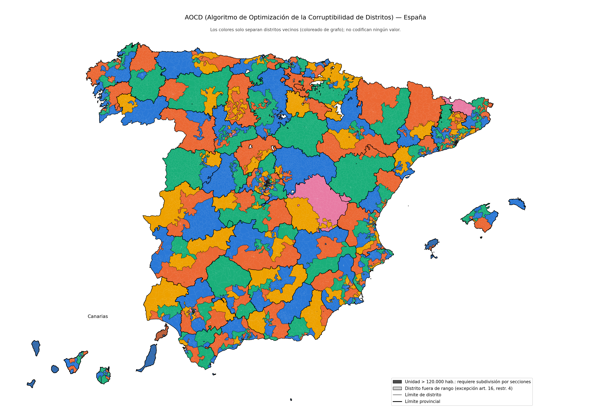

---
---
---
---

Ahora con esta definición, estos argumentos y estas limitaciones en mente, es hora de entrar en los detalles. Lo que sigue es una explicación de por qué cada artículo está redactado de la forma en la que está. Lo cual incluirá explicaciones de cómo cada artículo refleja las dinámicas descritas sobre la viabilidad e implementabilidad de la democracia ideal.

# TÍTULO I: PRINCIPIOS FUNDAMENTALES

## Artículo 1: Soberanía Popular y Jerarquía de Legitimidad

Cabe destacar en el primer artículo como el poder del pueblo, no es absoluto, pues debe tener límites por los motivos explicados anteriormente del trilema democrático. Un sistema que puede cambiar cuando sea a lo que sea es disfuncional. Sin embargo, aun sin ser absoluto, en cierta forma es soberano, pues siempre debe tener caminos para anular directamente decisiones de cualquier otro poder. Esos caminos son los que se nombran en este artículo y se describen en los siguientes.

Además de por las cuestiones nombradas anteriormente sobre la naturaleza humana, es necesario también declarar los límites entre los otros poderes, los poderes del Estado, deben ser específicos y calibrados. Pues, aunque en democracia son iguales e independientes, teóricamente, en la realidad, por su naturaleza, no son iguales entre sí. Y por ello se necesitan unas normas fundamentales que los equiparen en la medida de lo posible. Debido a que cada participante tiene naturalezas diversas pero definibles, no podemos conformarnos con dejar los límites más fundamentales entre estas arbitrarios a una mera legislación y debemos definirlos en la Constitución.

Es relativamente fácil entender por qué los poderes no son iguales entre sí en su estado más puro, más natural. Pues el ejecutivo tiene al ejército, y si alguien tiene una pistola, o un ejército de gente con pistolas, es claramente más fuerte que tú. Por ende, si su voluntad lo ansía, y si su inteligencia le permite coordinar a su ejército, podrá ejercer su voluntad contra la tuya. Este es por ejemplo un límite físico y real el cual, a día de hoy, es inevitable y lo único que podemos hacer es limitarlo mediante acuerdos sociales, normas escritas estructurales y seguidas al pie de la letra, con una religiosidad cual mandamiento, para establecer un orden y un funcionamiento social lo más democrático posible.

Esos límites son los que se describen a lo largo de esta Constitución y se referencian en este primer artículo cuyo objetivo final es el descrito, que, en la medida de los límites físicos de la naturaleza y funcionamiento humano, equiparen a las 3 funciones delegadas al Estado a un nivel democrático.

Así resumiría la razón de ser de este artículo: reconocer que existen límites físicos inaludibles en la realidad que se oponen al ideal demócrata, pero a su vez, definir cuál es ese ideal: el pueblo nunca pierde su soberanía. Pues como seres humanos, aunque no podamos lograr la perfección, encontramos la prosperidad en el arduo y recompensante camino que nos acerca a ella.

// TODO, incorporar arriba lo siguiente ó quizá cuando lleguen los otros artículos
Los principios básicos que describen estos mecanismos de control entre los participantes del sistema democrático, que son las tres funciones delegadas y el pueblo, están basados en la siguiente idea. La idea de que un castigo lo suficientemente grande ante la violación de tus responsabilidades, detectado y consolidado por una capacidad de autodestrucción mutua entre los participantes de un sistema, genera los incentivos necesarios para que dicho sistema funcione conforme a lo esperado en la mayoría de los casos. Y en aquellos en los que no funcione, que se autocorrija. Al igual que en los algoritmos de consenso en las modernas redes blockchain.

Al igual que en el trilema de las blockchain, estos límites generan el trilema democrático anteriormente mencionado. En algunos casos se opta por maximizar una de las tres opciones, en otros casos, otra, los porqué serán analizados conforme vayan apareciendo.

## Artículo 2: Niveles de Consenso

Los seis niveles de consenso son la herramienta operativa de toda la Constitución. Cada nivel representa un grado distinto de acuerdo social, desde la mayoría simple hasta el consenso casi unánime. Usando una terminología más clásica: N1 (51%) es mayoría simple, N2 (60%) mayoría reforzada, N3 (66%) mayoría cualificada ó de dos tercios, N4 (75%) supermayoría, N5 (85%) supermayoría reforzada y N6 (95%) cuasi-unanimidad.

El texto constitucional usa exclusivamente el porcentaje como definición formal, sin etiquetas descriptivas, para evitar ambigüedades como la que existiría con "dos tercios", que podría ser 66,66% si truncas los decimales, ó 66,67% si redondeas. Por eso mismo el artículo fija que todo porcentaje de esta Constitución, sea un nivel, un umbral de firmas ó una participación, se trunca al entero inferior cuando no da entero: el 10% de 80.001 son 8.000 firmas, no 8.001, y nadie puede discutir el borde. Este artículo define de manera modular, cual software, una referencia que será utilizada a lo largo del texto, haciendo a este más legible y fácil de modificar sin liar los artículos y romper el sistema. Siguiendo dos principios del buen desarrollo de software, el llamado SoC (Separation of Concerns), separación de preocupaciones, en español y el llamado DRY (Don't Repeat Yourself), no te repitas, en español. La idea es que si se quiere cambiar el porcentaje de consenso necesario para un artículo, solo se cambia aquí y no en cada artículo que lo requiera. Estos principios se ven en la decisión de crear este artículo, pero se repiten a lo largo de toda la Constitución. Pues al fin y al cabo, esto es un código legal, y como buen código, aunque no sea software, se le pueden aplicar los mismos principios arquitectónicos de diseño y desarrollo sostenible.

La idea detrás de estos porcentajes es que decisiones más trascendentales requieran acuerdos más amplios: cambiar una ley ordinaria necesita consenso de N1 en el parlamento, pero modificar una cláusula pétrea necesita que se den condiciones más complejas y exigentes. 

Los parámetros protegidos a N6 son aquellos que definen la estructura fundamental del sistema electoral y los mecanismos de control democrático directo: cómo se elige, cómo se revoca y cómo se cesa. Modificar estos parámetros altera de la forma más fundamental del equilibrio de poder entre el pueblo y sus representantes, por lo que requieren cuasi-unanimidad sostenida en el tiempo. Sin embargo, ninguno en sí es de por sí inamovible. Pues, al fin y al cabo si la mayoría lo desea lo suficiente, la democracia debería ser capaz de aceptar su final. Esta decisión se basa en confiar en que respetar la naturaleza humana es mejor que pretender inventarla. Como seres humanos, no siempre necesitamos tomar decisiones con consensos sociales amplios, nuestra naturaleza deja lugar a diferentes formas de organización, y por ello, nuestra Constitución debería representarla. Pues un sistema que es fiel a su realidad, se adapta mejor a ella.

Los parámetros protegidos con un nivel más bajo, N5, son estructurales y muy fundamentales, pero no están tan estrechamente relacionados con el control de dinámicas de poder entre las diferentes partes, sino que están relacionados con el funcionamiento óptimo y limitado del Estado como la composición judicial, requisitos de acceso a cargos judiciales etc

El resto de parámetros a ajustar, ó artículos a modificar, se rigen por el procedimiento de reforma ordinaria descrito más adelante en el artículo 71.

## Artículo 3: Sujetos Constitucionales

La Constitución necesita un vocabulario preciso para sus sujetos, igual que un programa necesita estructuras de datos bien definidas. Sin esta definición, cada artículo que dice "ciudadano" es ambiguo: ¿incluye a un turista? ¿A un menor? ¿A un residente sin nacionalidad? La ambigüedad terminológica es un vector de ataque interpretativo: un tribunal creativo puede expandir o restringir el alcance de un derecho según cómo interprete "ciudadano".

Las categorías persona, ciudadano, ciudadano con derecho a voto son subconjuntos entre ellas. Es decir, persona es el conjunto total, ciudadano es un subconjunto completamente incluido en persona, y ciudadano con derecho a voto es un subconjunto completamente incluido en ciudadano. Dicho de forma menos matemática: todo votante es ciudadano, todo ciudadano es persona, pero no necesariamente al revés. Esto permite que derechos como la integridad personal apliquen a toda persona (incluidos turistas, refugiados, residentes sin nacionalidad), mientras que capacidades políticas como votar o iniciar revocaciones se reserven a ciudadanos con derecho a voto.

El artículo define también qué es el censo de un distrito: los ciudadanos con derecho a voto que lleven al menos cuatro años censados en él, y hasta cumplirlos se sigue perteneciendo al censo del anterior. Es una sola definición que luego usan la revocación, las elecciones y las candidaturas distritales sin repetirla, y es la defensa contra la migración masiva coordinada que se explicará más adelante. Quien se muda no pierde el voto, pero tarda cuatro años en poder usarlo en su nuevo distrito. El plazo va a N6 porque, como todo lo que define quién vota dónde, es cómo se elige.

Y no es solo defensa. Hay un principio de fondo: si no vas a vivir ni cuatro años en un sitio, no eres de allí y no tienes voz allí. Las decisiones de un distrito las deben tomar quienes van a vivir sus consecuencias, y cuatro años, un mandato entero, es la medida mínima de eso. Así se prioriza el pensamiento a medio y largo plazo sobre el cortoplacismo de emociones e impulsos, que en sistemas grandes y complejos ayuda poco.

La cláusula de excepción de la garantía de derechos incluye la frase "o en ley conforme a ella", expandiendo la capacidad necesaria de restringir derechos, como el de libre circulación para delincuentes, sin sacrificar los límites definidos en la Constitución. Los derechos son un acuerdo social con consequencias y poder, por lo cual también requieren de ciertos límites en La Constitución, estos se definen a lo largo de posteriores artículos.

// TODO: revisar si de verdad en todos los articulos se sigue este enfoque sobre: expresamente prohibido, y si no permitido. Y ver si eso crea un vació legal/vector de ataque.
En este artículo también se puede observar que esta Constitución adquiere el caracter de: "si no esta expresamente prohibido, está permitido": cada categoría goza de todos los derechos de su nivel salvo restricción expresa. Esto minimiza el texto necesario y reduce la superficie de ataque interpretativo: si la Constitución no dice explícitamente que un derecho está restringido para una categoría, no lo está. Si la Constitución dice que un derecho siemmpre está accesible para una categoría, lo estára siempre, y cualquier ley que lo prohiba, será anticonstitucional. Intuitivamente, se tarda menos en describir los límites de lo no permitido que declarar firmemente lo que sí está permitido.

Una amenaza a tener en cuenta: la nacionalidad se define "conforme a la ley", así que el Legislativo podría endurecer ó aflojar quién es ciudadano para cambiar el electorado sin tocar técnicamente el derecho al sufragio del artículo 5. Es un vector de ataque lento: cada cambio individual parece razonable, pero acumulados van moviendo quién decide. Por eso existe el artículo 4. Fija un suelo que ninguna ley puede tocar, la nacionalidad garantizada a los arraigados y los cinco años mínimos para nacionalizarse, y exige N4 a cualquier ley que regule el resto. Con eso, quitarle la nacionalidad a los de siempre es imposible y endurecer ó aflojar la nacionalización sale caro. No queda cerrado del todo: un Legislativo con el 75% todavía puede endurecer la nacionalización por encima del suelo, encogiendo el electorado futuro aunque no el presente, y una ley así solo podría anularla el pueblo con el 75% del censo, que en la práctica es inalcanzable, ó con una revocación alta de representantes para que vuelvan a alterar la ley. Es una limitación consciente: definir toda la nacionalidad en la Constitución la haría rígida ante las realidades demográficas siempre cambiantes de las sociedades humanas. Se opta por un suelo fijo y el resto flexible con contrapesos.
// TODO: igual el 75% del censo no es inalcanzable. Analizar la participación en elecciones en España y en otros países. Además, en una sociedad que tiene esta Constitución y es consciente de la participación, es previsible que esos porcentajes sean algo más altos.

## Artículo 4: Nacionalidad

La nacionalidad es la frontera social del pueblo, y el pueblo es quien tiene el poder en democracia. Por ende, no cualquiera debería ser parte de él. Pues sería absurdo que alguien que acabas de conocer se mude a tu casa, con ó sin tu permiso, y al día siguiente ya lo consideres un miembro de tu familia de toda la vida, ó un amigo íntimo por el que hacer sacrificios extraordinarios. Esa actitud abre la puerta a que el externo se aproveche. Por eso, a nivel constitucional, se definen los límites más fundamentales y objetivos que hacen a una persona parte de un grupo que comparte un modo colectivo de vivir, de una nación. El resto se deja a la ley.

Cabe destacar que esto no es un argumento moral. Ni tú ni el extranjero sois superiores el uno al otro, ni inferiores; a nivel humano sois iguales. Sin embargo, por cuestiones naturales, quien lleva más tiempo en un sitio y tiene la fuerza para controlarlo decide quién vive ahí, quién no y como influencia ese entorno. No justifico esto en ninguna moralidad ni superioridad nacional, sino en una cuestión de puro poder grupal, que es imprescindible conservar si se pretende mantener a una sociedad viva e independiente. Igual que un humano atado, ó al que golpean cada vez que intenta moverse, no es ni libre ni independiente ni capaz aunque técnicamente pueda moverse, una nación no puede funcionar como grupo si la limitan cuerdas artificiales y golpes externos. Solo deben limitarla las normas naturales y fundamentales que rigen cómo se agrupan los humanos. Y esas normas, las que se pueden definir objetivamente, deben estar escritas en la Constitución.

Lo que sí se deja a la ley exige un consenso alto, N4, porque si no se atenta contra la capacidad e incluso la vida del propio sujeto nacional. Este es además el vector de ataque que ya se señala en el artículo 3: un Legislativo que no puede restringir el sufragio pero sí endurecer, ó aflojar, quién es ciudadano, está manipulando el electorado y aprovechandose del sistema. Con N4 ese cambio ya no sale barato. Durante el Arranque basta N3, como con casi todos los parámetros de esta Constitución, para que el sistema pueda configurarse sin bloqueos en su etapa más frágil.

Entiendo la nacionalidad como ser alguien que de verdad vive ahí. Alguien que es parte de un pueblo no es alguien que ha pagado por ello: es alguien que vive con el grupo y es aceptado por él durante un tiempo prolongado. Por eso los cinco años mínimos para nacionalizarse, y por eso solo cuentan los periodos de al menos cuatro meses seguidos: para que vivir aquí signifique vivir aquí, y no coleccionar estancias cual turista. Los siete días de ausencia por periodo no son vacaciones, son margen para emergencias, un familiar enfermo en el extranjero al que hay que ir a ayudar, por ejemplo; sin ese margen, una desgracia fuera te borraría cuatro meses de residencia, y eso es bastante cruel por decirlo suave. Es verdad que una nación es más que tiempo compartido, es una tradición y un modo de vivir parecidos, y que cinco años no garantizan que alguien se haya adaptado. Pero sí ponen una barrera razonable para que tenga tiempo de hacerlo. Nótese que nada impide que la ley añada exámenes de adaptación ó requisitos extra; la Constitución solo fija el límite mínimo. A nivel constitucional me ha parecido fundamental limitar la facilidad con la que se adquiere la nacionalidad exigiendo un sacrificio de algo que nunca vuelve, el tiempo, que es justo lo que no está dispuesto a pagar quien la quiere por oportunismo ó conveniencia.

Este límite tiene también otra cara: se protege a quienes su legado familiar y cultural es lo suficientemente viejo. Si tus cuatro abuelos y tus padres nacieron y se criaron aquí, y tú también, eres parte de esta cultura y de esta nación, y ninguna ley puede decir lo contrario. Criarse aquí tiene cifra exacta, al menos el 51% de los días entre el nacimiento y la mayoría de edad, y la cifra es la misma para ti que para ellos. Esta garantía es lo que hace imposible el ataque inverso: encoger el electorado quitándole la nacionalidad a los que siempre han estado ahí.

Por eso el artículo es cláusula pétrea. Lo que la ley regula va a N4; lo que la Constitución garantiza, el límite temporal de la nacionalización y la nacionalidad de los arraigados, solo se toca por el procedimiento del artículo 70. Es el mismo patrón que la edad de voto del artículo 5: un proceso que el Legislativo puede calibrar dentro de un rango que el Legislativo no puede mover.

## Artículo 5: Derecho al Sufragio

El sufragio no puede restringirse. La justificación es directa: por el mismo argumento del bucle de retroalimentación, cuantos más ciudadanos participen en el proceso democrático, más perspectivas entran en el sistema, más información se procesa y mejor es la capacidad colectiva de encontrar soluciones óptimas. Restringir el sufragio es empobrecer el bucle. Cualquier excepción (como declaraciones judiciales de incapacidad) abre la puerta a la restricción arbitraria del voto por motivos políticos: un juez corrupto podría declarar "incapaces" a miles de votantes en un distrito clave. El riesgo de abrir esa puerta supera al beneficio de cerrarla. Lo mismo, y por las mismas razones, ha sido dada la capacidad de sufragio a aquellos que sean criminales, pues la ley no es la verdad pura del deseo de una nación y puede ser corrompida, temporalmente a corto ó incluso a largo plazo, por ciertos grupos. Aunque sí que es verdad que en un sistema democrático se espera que si la ley se corrompe, gracias a los mecanismos de esta constitución, sea por poco tiempo.

En términos generales, abrir la puerta a que ciertas condiciones permitan excluir votantes es una puerta extremadamente difícil de vigilar en democracia. La atención humana es un recurso limitado: los ciudadanos no pueden prestar atención a todo lo que se legisla simultáneamente. Y en la era actual, con la adicción al internet y las redes sociales, es más fácil que nunca distraer a la población mientras se legisla para, poco a poco, ir restringiendo quién puede votar y quién no usando vocablos pompantes y rimbombantes para confundir a la gente con aires de elitismo. Espero que este texto no tenga demasiado de lo nombrado, intento reducirlo todo lo que puedo. El caso, este es un vector de ataque lento y silencioso: cada restricción individual parece razonable, pero acumuladas van extrayendo poder del pueblo. Es preferible y diría vital no abrir esa puerta en absoluto.

Sin embargo, por la propia naturaleza humana y siguiendo el principio de que aquel que es fiel a su realidad se adapta mejor a ella, el ser humano debería poder restringir el sufragio, pues es una actividad tan natural como otras. Sin embargo, ya que ataca al fundamento más fundamental de la democracia, solamente bajo condiciones y procedimientos como los definidos en el artículo 70, el cual está precisamente diseñado para asegurar que cualquier cambio de este tipo sea el resultado de una conciencia social profunda y no de un arrebato momentáneo de ira o manipulación mediante redes sociales u otros medios.

En todo caso, existen tres límites al sufragio que deben estar regulados mediante la constitución. Pues son relativamente claros, fáciles de entender y operables. Esto es debido a que su entendimiento no requiere de mucha carga cognitiva y por ende es muy fácil estar de acuerdo en ellos, por lo cual, han sido considerados fundamentales y obvios, y por ende, parte de la responsabilidad de La Constitución.

Estos no solo regulan quien puede votar, sino también la otra cara del sufragio, la pasiva: quién puede presentarse. Por razones lógicas, esto se aplica únicamente a los cargos públicos que "de verdad ejercen el poder": representantes y suplentes, Presidente, Vicepresidente y ministros, y los magistrados del Supremo.

El primer límite es el siguiente: solo quien puede votar puede ser votado ó nombrado; sería raro que alguien que no cumple las condiciones mínimas para decidir pudiera ejecutar lo decidido. Pues no puedes llevar a cabo exitosamente y con garantías aquello que eres incapaz siquiera de comprender. 

Los otros dos son los límites de edad y nacionalidad.

Un ciudadano puede ver como actúa la gente de 18 a 25 años y darse cuenta de que es una edad razonable. Un ciudadano entiende también que quien debe poder votar es aquel que claramente forma parte de la sociedad, alguien con la nacionalidad, y esa cuestión no depende de estudios científicos, matemática avanzada ni nada más, más que de sentido común e interacción y aprobación social.

El límite inferior de edad de entre 18-25 años ha sido elegido por una cuestión biológica, el cerebro humano alcanza un grado casi completo de madurez cognitiva sobre los 21 años, y deja de tener cambios estructurales alrededor de los 25. Debido a que la ciencia es cambiante, se mantiene el rango descrito. A día de hoy se cree científicamente que la corteza prefrontal participa especialmente en el razonamiento, planificación, control de impulsos, regulación emocional y evaluación de consecuencias, todas cualidades del buen votante, y esta parte del cerebro alcanza su madurez estructural aproximadamente a los 25.

El límite superior de edad es el menos obvio, y adelanto la conclusión a la que he llegado: nadie que haya superado los 63 años puede ser elegido ni nombrado para los cargos de poder especificados arriba. Por las razones que explicaré ahora, la edad podría ser un límite natural a la posibilidad misma de democracia en una nación. Genera un conflicto irreconciliable entre dos de sus tres pilares, y ese conflicto, en una población envejecida, lleva al riesgo de una oligarquía temporal forzosa, ya sea a manos de la juventud ó de un grupo de viejos bien organizado.

El principio detrás es uno de los más fundamentales de la democracia, como se entiende de la obra de Antonio García Trevijano: a quien no se le puede exigir responsabilidad mediante control y castigo no se le debe dar poder, pues el poder sería transferido y no delegado. Sin revocabilidad, es decir, sin consecuencias ante tus actos, el poder no se controla, se transfiere del todo, y lo que queda es confiar en la honestidad del elegido. Pues bien, hay una responsabilidad que ningún mecanismo puede exigir: vivir las consecuencias de lo que decides. Las consecuencias más fundamentales de una decisión de Estado son las de medio y largo plazo, y largo plazo, en una sociedad humana, es un periodo generacional, de 21 a 25 años, el mismo ciclo de maduración cerebral del que sale la edad de voto. Quien pertenece a la generación más vieja ya no tiene generaciones por delante: no vivirá esas consecuencias y, por tanto, no puede responder personalmente ante ellas. Podrá influir con su sabiduría, con su experiencia a través de su voto, que no pierde, pero no aplicar el poder directamente. Porque abrirle las puertas al poder es abrir las puertas a confiar en que será empático con sus nietos, si los tiene, ó con sus compatriotas. Es exactamente el mismo acto de fe que el del poder sin revocabilidad, solo que en vez de confiar en la honestidad del elegido, confías en su empatía.

Se podría intentar corregir esto castigando a la descendencia si un viejo se corrompe en el poder. Plantea un dilema moral evidente, ¿deberíamos castigar a los hijos por los pecados de sus padres, ó incluso de sus abuelos? Pero aunque aceptásemos esa única excepción para heredar pecados, no se solucionaría: a lo único que llegaríamos es a dejar que la democracia dependa de dos hilos muy finos. El primero, ¿tenía el mandatario descendencia? Alguien viejo y en el poder perfectamente puede no haberla tenido. Y el segundo, ¿la quiere lo suficiente como para que le importe su futuro ó los castigos que se le puedan aplicar? Que la responsabilidad del mandatario cuelgue de hilos tan finos es, a efectos prácticos, una apuesta, no un argumento sistemático, sólido y duradero que garantice y explique una democracia duradera. Por eso considero que incluso con un castigo generacional no estaríamos en democracia: que se mantuviera no sería una garantía estructural sino, dicho burdamente, un capricho del amor y de cuánto ha follado sin protección un mandatario puntual.

El caso es que el límite superior a la edad no es un argumento basado en la incapacidad, aunque en ciertos casos también lo sea, pues la degeneración por vejez es inevitable. Es fundamentalmente un argumento de incentivos. La gente tan mayor no tiene incentivos naturales para mirar a largo plazo más allá de la empatía por sus jóvenes ó sus descendientes, y en los años recientes se ve, en muchos países y con regímenes políticos y económicos distintos, cómo poblaciones envejecidas toman decisiones económicas para garantizarse unos últimos años más cómodos a expensas de la prosperidad futura de la nación joven, y en situaciones extremas, incluso a expensas de su vida, provocando guerras. Que pase en todas partes independientemente del sistema es lo que me lleva a considerarlo un riesgo natural humano, y por tanto algo que limitar a nivel constitucional y no a nivel de ley. El futuro de una nación no depende de los viejos aunque sean el 80% de ella; depende del 20% que seguirá vivo para llevarlo a cabo.

Escogí el número 63 con una fórmula sencilla: esperanza de vida menos un ciclo de maduración cerebral, es decir, entre 21 a 25 años. He sido conservador en las dos cifras. Para la esperanza de vida he cogido la más alta que existe hoy, la de España y Japón, unos 84 años. Y he restado solo 21, no 25. Eso da 63, y me parece una edad razonable: hasta ahí, a día de hoy, la gente sigue siendo lúcida; a partir de ahí se empieza a decaer. Considero válido haber sido conservador en las cifras obtenidas para el cálculo y haber caído en el 63 por motivos de sentido común basado en mi experiencia vital a día de hoy.

En la Constitución solo aparece el número derivado, no la fórmula, y no lo he atado a ningún recálculo automático en ningún ciclo. Que la esperanza de vida suba depende del avance de la medicina, del estilo de vida, de las condiciones del entorno, y eso no sigue un ritmo natural que se pueda prever ni al que se pueda enlazar una norma. Así que la actualización se deja a mayoría y votación: el Legislativo puede elevar el tope con N5 si la gente vive más y más lúcida, pero nunca bajarlo de 63, pues el riesgo que limita este artículo es que quienes ya no van a vivir el futuro decidan sobre él, destuyendo uno de los principios democráticos, y ese riesgo solo empeora si el tope baja. Casi seguro que en un futuro no muy lejano, unos 30 años, habrá que tocar este número.

Ahora el conflicto que adelantaba. En una población muy envejecida, en la que la mayoría sean viejos, por mucho que puedan votar, si sus intereses van en contra de los de quienes pueden ser elegidos, estaríamos creando una situación muy inestable: un ciclo vicioso de revocaciones frecuentes de representantes de distrito. Los mayores estarían forzados a elegir jóvenes, estos harían probablemente lo que sus intereses de jóvenes dictan, y serían revocados una y otra vez. Es menester advertirlo aquí, e iniciar los procedimientos de reforma adecuados si se ve venir esta situación en alguna nación con esta Constitución. Pues en este caso excepcional dos de los tres pilares de la democracia chocan de forma irreconciliable: la rendición de cuentas y la competencia abierta por el poder. Si la competencia es abierta en base al criterio más fundamental, la lucidez, los ancianos lúcidos pueden ejercer el poder, aunque en la práctica, como ya he explicado, eso sea un acto de fe en su empatía más que una garantía de responsabilidad estructural y real.

Tenía, por tanto, dos opciones. La primera, no limitar la competencia por el poder y basarla solo en la lucidez. Pero eso no quita que quien va a morir pronto no tiene nada que temer del castigo, así que, aunque la competencia esté abierta y no haya inestabilidad por poder elegir solo a jóvenes, habría inestabilidad por otro lado: la corrupción sistemática de un sistema que carece de responsabilidad efectiva, con un gran riesgo de deteriorarse en oligarquía, rápido, antes de que mueran, acumular riqueza mediante abuso de poder, disfrutarla lo poco que les queda, e incluso, si son empáticos, dejársela a sus descendientes. Nótese, que en esta caso, la empatía en vez de estar a favor de la democracia, estaría en su contra.

La segunda opción, la que he elegido, es limitar la edad de quien ejerce el poder y asumir el ciclo de revocaciones como un riesgo conocido. Porque la democracia más pura en una población envejecida es un riesgo real para la mera existencia de esa nación y de la democracia misma: aunque la mayoría sea vieja y vote a viejos, por el mismo principio de que en la práctica poca responsabilidad se les puede exigir, la democracia en sí se rompe, y se convierte en una lucha de la oligarquía joven por el poder ó en un sálvese quien pueda corrupto entre los vejestorios. He llegado a la conclusión de que la democracia tiene otro límite real y natural, una población envejecida, y como ya aclaré al comienzo, la democracia ideal no existe, hay que elegir contra qué límite chocar.

De este mismo argumento se deduce que darles el derecho a voto a los viejos es arriesgarse a matar la democracia, pero solo en poblaciones envejecidas. En circunstancias normales, su voto enriquece el bucle de retroalimentación explicado arriba, y como el caso peligroso es la execpción, no he limitado la parte activa del sufrago, es decir, el voto, a los viejos. Me conformo con haber avisado aquí de su peligro, confiando en que una nación democrática informada, antes de que llegue el momento previsible de una población envejecida, tome medidas al respecto: fomentar la natalidad, ó iniciar con tiempo la reforma constitucional para quitarles el derecho a voto a los viejos y que no se carguen la estabilidad de la nación. Si que es verdad que una nación en esa situación se convertiría en una oligarquía inevitable, temporal, hasta que la mayoría muriera de vieja y se volviera a reformar la Constitución para que pudieran votar de nuevo. Esa es la oligarquía forzosa a la que me refería al principio. Con lo que, ante el riesgo de perder la democracia por el límite natural de la vejez mezclado con una población en dirección a envejecerse, sólo nos queda una opción muy divertida al comienzo de su ejecución, y más tediosa después, tener hijos. Así que aquí queda mi advertencia, si una sociedad se encuentra en tal tesitura, perdónenme el lenguaje brusco y algo humorístico, pero, la única solución viable, es follar.

Dejando atrás el límite natural de la edad, pasemos a explicar el límite de la nacionalidad, es bastante más complejo que el de edad. No por nada cada país actual tiene criterios muy diversos para cómo un extranjero puede llegar a adquirir la nacionalidad ó para decidir quien la posee por simplemente nacer. El quien es parte de una sociedad, un ciudadano, es una cuestión multifactorial, ¿habla el idioma?, ¿es aceptado por la sociedad?, ¿tiene familia ya ciudadana ó muchos amigos ya ciudadanos?, ¿practica y comparte tradiciones?, ¿vive en el territorio?, etc.

Entonces, aún por complejo que sea el tema, su justificación de existir es claramente fundamental y lógico: Tu vecino no vota sobre cuando tú vas a limpiar el interior de tu casa. Alguien que no es aceptado por tu sociedad, por tu grupo, tampoco tiene nada de poder sobre cómo este se organiza, porque no es parte de él, aunque viva cerca. Que por cierto, esto no niega la existencia del no ciudadano, pues gente así puede vivir con la sociedad, y su existencia afecta claramente a las decisiones que los miembros del grupo toman.

Lo que quiero decir es que, un pricnipio fundamental de un ente, es que la acción que usa para manifestar su voluntad es empezada y llevada acabo por el mismo ente. En cristiano, tú como ser vivo, usas la acción de crear reacciones eléctricas en tus neuronas que hacen que tu cuerpo se mueva para satisfacer tus necesidades, y solo tú empiezas eso de manera natural. Si queremos que la sociedad sea funcional y exista y se mantenga como un ser vivo, debemos aspirar a replicar estos mecanismos. La participación en el sistema político de la democracia es como aplicar impulsos eléctricos en las neuronas de la sociedad. Por ende, para replicar de manrea mas fiel a un ser vivo que sobrevive y prospera, solo aquello que es parte de esa sociedad, de ese grupo, debería poder iniciar dichos impulsos eléctricos, que, a nivel social, su analogía sería el derecho al sufragio.

Si se le permitiera a un ente ageno participar, eso, análogamente con la acción individual, sería como si se permitiera que las decisiones de una ardilla te controlaran, un absurdo desviado de las intenciones naturales, que, muy probablemente, acabe volviendo al balance, desaciéndose de tí, ó desaciéndose de la ardilla. No necesariamente matándote ó matándola, sino simplemente desconectándolo de alguna forma de su acceso a esa acción que procura el movimiento. En el caso individual sería desconectar a la ardilla de tus neuronas, y en el caso social sería restringiendo el derecho al sufragio.

Para terminar, la cuestión de la nacionalidad es tan fundamental pero incluso más compleja que la del sufragio, y por eso igual de susceptible de manipulación social y de campañas de operaciones psicológicas que intenten destruir la sociedad democrática. De ahí que el artículo 4 le aplique criterios de cambio igual de estrictos: la modificación de leyes que la regulen a N4, y un suelo blindado por los límites objetivos desarrollados más arriba respaldados por el artículo 70.

## Artículo 6: Propiedades Obligatorias del Voto

Tres propiedades simultáneas: secreto (nadie sabe qué votaste), verificabilidad (tú puedes comprobar que tu voto se contó correctamente) e indelegabilidad (sólo tú puedes emitir tú voto).

Estas tres propiedades son las características mínimas de cualquier sistema de votación legítimo. La Constitución no prescribe la tecnología (blockchain, criptografía, papel y urnas) porque lo que importa son las características que el proceso debe cumplir, no el método con el que las cumple. Si mañana surge una tecnología superior a la blockchain mezclada con criptografía de conocimiento cero (zero-knowledge cryptography), puede adoptarse sin reforma constitucional. Lo que permanece invariante son las características requeridas.

La legitimidad del voto emerge de la ausencia de coerción en el proceso, de la ausencia de corrupción del proceso y de la presencia de autenticidad en este.

Si el voto es secreto, será muy difícil que alguien te presione ó extorsione para votar de una forma concreta. Si es verificable, nadie puede falsificarlo sin que lo detectes. Si es indelegable, otorga autenticidad al voto garantizando un ciclo de retroalimentación realista, pues sólo tú lo emites.

Solo bajo estas propiedades cada individuo puede velar por sus intereses de manera honesta, y es en esta honestidad agregada donde se fortalece el bucle de retroalimentación que enriquece las soluciones democráticas. Haciéndolo auténtico y fiel a la realidad.

Estas garantías serían vacías sin consecuencias ante su violación. Por eso el artículo 6 establece un mecanismo de nulidad electoral y unas consecuencias mínimas si este se cumple. Si los votos afectados por una violación de las garantías son suficientes para haber alterado el resultado electoral, la votación es declarada nula y debe repetirse. Que la nulidad sea solo efectiva si hubiese alterado los resultados evita un vector de ataque al sistema: que un saboteador comprometa unos pocos votos para forzar la repetición de una elección que perdió.

Cualquier ciudadano con derecho a voto puede instar el procedimiento ante el Poder Judicial porque, tal y como se establece en el artículo 1, la soberanía reside en el pubelo.

## Artículo 7: Derecho a la Autodeterminación Territorial

Un territorio que quiere independizarse es, por definición, un demos: un pueblo con identidad y voluntad propias. Aunque sea minoría dentro del Estado, sigue siendo un grupo de seres humanos cuya soberanía merece respeto. Negar el derecho a la autodeterminación es negar que ese demos exista, lo cual contradice el principio fundacional de esta Constitución: que la soberanía reside en el pueblo.

Algunos profesionales de la cuestión nacional argumentarán que ciertos movimientos independentistas no son lícitos porque no se han formado de forma orgánica: no existe un sujeto colectivo forjado por una larga historia, unas tradiciones y demás componentes que solidifican una nacionalidad. Mi crítica a este punto de vista es una pregunta: ¿a partir de qué límite se considera algo ilícito, lícito? ¿Cuando el movimiento dura más de dos generaciones, tres, con una vale? ¿Y si ha sido promovido mediante propaganda, extremismo y mentiras estadísticas, para despertar con argumentos falsos a una parte de la población y así debilitar a la nación, se debería respetar?

En mi opinión, basada en una visión pragmática, sí. Pues incluso en el peor de los casos, el de un movimiento de origen artificial y manipulado, una vez la mecha está prendida y la gente está organizada bajo un sentimiento, es muy difícil de parar sin caos ó violencia. Por ende, una válvula de escape legal, civilizada, paciente y pacífica para esa presión es vital para evitar tensiones mayores derivadas de negar la existencia de un nuevo sujeto político dentro de una nación.

Ahora bien, que el camino exista no quiere decir que deba ser fácil. Y aquí el tiempo es el mejor filtro que conozco. Si el conjunto de factores que unen a ese grupo, una cultura algo ó muy diferente, otra lengua, una religión ó cualquier otro rasgo que contribuya a una identidad nacional, es algo conforme a la realidad y con lo que ese grupo de verdad se identifica, durará generaciones. Si solo es un arrebato de una generación antigua, y sus hijos repudian aquello más que a la nación de la que se querían independizar, no hay un fundamento real y honesto que justifique la diferencia entre naciones.

Pues con cada generación que pasa, la idea de una nueva, ó algunos dirán, no descubierta todavía, nación, se somete a todo tipo de estímulos reales que ponen a prueba cuán real es: las nuevas personalidades, las relaciones entre ellas, el paso de la idea nacional mediante los fundadores vivos, y después mediante los fundadores muertos. Si tras tres generaciones, cuando aquellos que iniciaron el movimiento ya murieron, sus ideas siguen convenciendo hasta a los hijos de sus nietos, entonces tiene que haber un fundamento tan real que aguanta a cualquier arrebato de las personalidades que lo iniciaron, ya fueran corruptas y manipuladoras, ó gente que de verdad era fundamentalmente distinta.

Por eso mido los límites de este artículo en generaciones, tomando como generación los 21 a 25 años que tarda en madurar el cerebro humano, cuestión ya tratada en el artículo 5. Y por eso, siendo coherente con lo anterior, el mínimo debería ser de tres generaciones: 63 años, con un máximo de 75. No lo es. El mínimo es de una generación, 21 años, porque dudo de mi propia argumentación. La idea de que los límites de una nación se puedan medir por la maduración de sus generaciones es mía, va en contra de bastante pensamiento tradicional sobre qué define una nación, y prefiero dejar la puerta abierta a que estudiosos más expertos que yo en la materia la refuten ó la refinen, antes que cerrarla en una Constitución con un mínimo de 63 años. Una generación ya basta para distinguir un movimiento real y sostenido de un impulso circunstancial, y dificulta mucho que un proceso exitoso provenga de un ataque a la nación por potencias extranjeras ó poderes malévolos internos. Si algún día quedo convencido, los límites serán 63 y 75.

El límite temporal no debería ser el único, pero sí el único constitucional. Pues los otros límites no son ontológicos a la realidad de un grupo social humano, sino fruto de decisiones puntuales entre los dos sujetos nacionales que afrontan el proceso. Por ejemplo, es razonable y discutible exigir que el territorio no tenga deuda pendiente con el Estado, que demuestre autosuficiencia en servicios esenciales ó que cuente con capacidad de defensa propia. Estos requisitos pueden ser exigentes, de ahí que esa misma frase esté en el artículo. Lo que no pueden es estar indefinidos en el tiempo ni resolverse precipitadamente, negando a la realidad manifestarse ó dando poder a una mentira y por ello creando conflicto social.

De ahí los dos límites temporales. El mínimo de 21 años, una generación, el mismo ciclo biológico del artículo 18, permite divisar un movimiento independentista real y sostenido. El máximo de 63 años, tres generaciones, impide la obstrucción indefinida: un proceso que dura más de tres generaciones no es un proceso, es una denegación de la realidad disfrazada de burocracia.

Y de ahí también el periodo de espera. Que una realidad no exista hoy no quiere decir que no pueda aparecer mañana, así que un proceso resuelto, sea cual sea el motivo, incluso la aprobación, aunque en ese caso no tenga mucho sentido, no cierra la puerta para siempre: ese territorio podrá volver a intentarlo pasada una generación. Los 21 años son el mismo filtro de antes aplicado al fracaso: tiempo suficiente para que la idea, ya rechazada una vez, se ponga a prueba con la generación siguiente.

La clave es que el derecho a iniciar el proceso no puede suprimirse. Las condiciones son negociables; la existencia del camino no lo es.

Una duda abierta es el nivel de protección de este artículo. Actualmente no es cláusula pétrea, por lo que puede reformarse mediante el procedimiento ordinario (N4 legislativo ó referéndum con N1 y participación de N2, el 60% del censo). Esto significa que un legislativo con el 75% de los escaños podría, en teoría, eliminar el derecho a la autodeterminación. ¿Debería ser pétreo? El argumento a favor es claro: es un derecho fundamental de los pueblos. En contra hay dos. Uno, que la independencia territorial involucra factores que exceden lo constitucional, tratados militares, acuerdos económicos, relaciones internacionales, y un nivel de protección excesivo podría rigidizar situaciones que requieren flexibilidad. Y dos, es el mismo que me lleva a un mínimo de una generación: aunque prefiera mi análisis, aún considero que pueda estar equivocado por no estar teniendo algo en cuenta, y blindar como pétreo algo de lo que uno duda no es prudente. Por ahora lo mantengo como reforma ordinaria, pero es un punto que merece debate.

---
---

## Artículo 8: Igualdad ante la Ley y Responsabilidad Pública

El principal argumento para incluir este artículo es que la inmunidad parlamentaria es un concepto oligárquico. Fundamentalmente dice: "nosotros estamos por encima de la ley". Esta Constitución lo rechaza pues la desigualdad ante la ley, por lo menos aquella derivada de la superioridad legal de los gobernantes sobre los gobernados, es un fenómeno que promueve y acelera la formación de oligarquías.

Si votaste a alguien, esa persona es responsable ante ti y ante la ley de igual a igual, y en todo caso, aún más responsable, pues el representante adquiere el carácter de empleado del pueblo, y como empleado, debe obedecer a sus jefes y rendir cuentas cuando no lo haga.

Que cualquier ciudadano pueda iniciar el procedimiento es una mera declaración explícita, para que no se filtre quién puede y quién no puede acceder a un proceso judicial de esta índole.

Sin embargo, la eliminación de inmunidad abre un vector de ataque, el de denuncias frívolas masivas como herramienta para paralizar ó chantajear a cargos públicos incómodos. Se espera, aunque no esté fijo en esta Constitución por cuán complejos pueden ser los casos, que un cargo público procesado siga ejerciendo hasta condena firme, y también la existencia de leyes anti-abuso procesal. Lo que sí fija este artículo es que iniciar un procedimiento es gratuito, y no solo este: cualquiera de los que esta Constitución deja iniciar a una persona ó a un ciudadano. Si costara dinero, no seríamos iguales ante la ley, y los mecanismos de control de esta Constitución estarían al alcance de quien pudiera pagarlos. Además, la tramitación preferente, que este artículo obliga a que exista dejando el método a la ley, mitiga parcialmente la parálisis al resolver más rápido los procesos contra cargos públicos honestos. Así se equilibra responsabilidad y protección frente a abusos, tanto si abusa el cargo público como si abusan de él.

La protección extra a N5 de la inhabilitación permanente impide que un Legislativo con mayoría ordinaria (N4) rebaje esta consecuencia para proteger a aliados condenados. Y es permanente por defecto porque esa persona ya ha demostrado que la disuasión por castigo y revocación, que crea uno de los tres pilares fundamentales de la democracia, el de la representatividad responsable, no funciona con ella.

## Artículo 9: Lengua Oficial

Un Estado necesita una lengua común para funcionar. Sin ella, las leyes se redactan en lenguas que parte de la ciudadanía no entiende, los procedimientos judiciales se vuelven inaccesibles y la administración pública se fragmenta. La lengua oficial no es una imposición cultural: es infraestructura operativa del Estado, al mismo nivel que el sistema electoral o la separación de poderes.

Una sociedad sin una lengua común es demasiado caótica y como todo sistema, cuanto más caos más fácil es que se rompa.

¿Por qué cláusula pétrea? Porque la lengua oficial es condición necesaria para que todos los demás mecanismos constitucionales funcionen. Si un Legislativo pudiera eliminar la lengua oficial por reforma ordinaria, podría fragmentar la comunicación estatal como herramienta de control: leyes incomprensibles para parte de la población, procedimientos judiciales inaccesibles, educación desigual. Una lengua común iguala a todos ante la ley.

Dejar por defecto la lengua del régimen anterior garantiza continuidad operativa desde el primer día de la Transición. Sin este default, habría un vacío. El default resuelve esto sin imponer una decisión permanente ya que durante el Arranque, el Legislativo puede confirmar o cambiar la lengua oficial.

El umbral N4 (75%) para modificar la lengua durante el Arranque es intencionalmente alto para una decisión de Arranque. La mayoría de parámetros se configuran con N1, pero la lengua oficial afecta a toda la población de manera profunda y muy dificilmente reversible en la práctica: cambiar la lengua de la legislación, la justicia y la educación no es un ajuste técnico, es una transformación social. El N4 exige un consenso amplio que refleje una voluntad real, no una mayoría coyuntural.

La cooficialidad por legislación ordinaria permite adaptar el sistema a realidades lingüísticas territoriales sin debilitar la lengua común. Un territorio bilingüe puede operar en ambas lenguas, pero la lengua oficial siempre está presente como garantía de que cualquier ciudadano del país pueda entender las leyes y acceder a la justicia en cualquier territorio.

---
---

# TÍTULO II: SISTEMA ELECTORAL

## Artículos 10 a 15: Representación por Distritos

La representación uninominal (un distrito, un representante) proviene del modelo de Trevijano. ¿Por qué no listas de partido? Porque las listas convierten al representante en servidor del partido y de la burocracia que ahí le hizo llegar, no del electorado. En un sistema de listas, el votante elige un partido; en un sistema uninominal, elige a una persona concreta a la que le puede exigir cuentas de forma mucho más directa y fácil.

La revocación solo funciona con una representación uninominal: no puedes revocar a un partido sin establecer mucha burocracia de por medio, otro de los factores que promueven la generación de oligarquías, pero sí a un individuo. Además, castigar o exigir cuentas a un grupo es inherentemente más complejo y ambiguo que hacerlo a un individuo: la responsabilidad se diluye, las culpas se reparten, los culpables se cubren los unos a los otros, las caras del partido cambian y el culpable huye y el resultado tiende a errores e impunidad. La delegación más eficaz, eficiente y controlable es la que se realiza en una sola persona.

Esta es la diferencia entre poder delegado y poder transferido. En un sistema de listas, el ciudadano transfiere su poder al partido: una vez entregado, no lo recupera, quizá sí en el mundo de las ideas y la teoría, pero no en la práctica, hasta la siguiente elección. En un sistema uninominal con revocabilidad, el ciudadano delega su poder en un individuo concreto y puede retirárselo. El poder delegado permanece en el demos; el poder transferido sale y se escapa de él. Sin distritos uninominales, la revocabilidad es imposible o ineficaz por los motivos mencionados, y el poder se transfiere en lugar de delegarse.

Por eso el artículo 11 es corto a propósito: los representantes serán siempre revocables por el pueblo (únicamente bajo las restricciones constitucionales de quién puede votar etc ya explicadas) del distrito que los eligió, y ninguna ley ni poder del Estado podrá suprimir ese derecho. Es la otra mitad del artículo 10. Allí se dice que el poder se delega y no se transfiere; aquí se garantiza la herramienta que hace esa diferencia real. Sin revocabilidad, el poder delegado es poder transferido, pues no ostentas poder sobre aquello que no puedes alcanzar. Por eso la revocabilidad es cláusula pétrea en el artículo 69, y por eso los parámetros de los artículos 12 y 13, y el arraigo del artículo 3, están a N6: son, literalmente, cómo se elige y cómo se revoca al representante del distrito, dos pilares de la democracia. El método de recuento del artículo 14 queda un nivel por debajo, a N5, porque es el bloque que quizá se cambie, como explicaré más abajo.

El 51% no es casual: es el mismo "más de la mitad" del N1 del artículo 2, el principio de legitimidad del que parte todo el sistema, y el mismo del que se deriva el 75% de la revocación. Elegir y revocar usan la misma vara.

Los umbrales y procedimientos de elección parten todos de un axioma: la legitimidad acordada en el 51%. A medida que me informe y estudie mejor otros métodos de elección mediante el análisis del campo matemático de la teoría de la elección social, quizá concluya en otro método de elección distrital, como el voto por orden de preferencia ("ranked choice voting"). En todo caso, el método con el que se calcula el ganador, hoy el artículo 14, es solo un bloque intercambiable dentro de un sistema de varios: la revocabilidad, la representación por distritos, los plazos entre votaciones y lo que las activa no cambiarán.

El umbral del 75% para revocar no es arbitrario. Sale de la misma mecánica del consenso con la que se elige. En una elección normal se gana con el 51%, es decir, aceptamos que "más de la mitad" significa legitimidad. Para revocar a alguien elegido con ese 51% no basta con hacerle perder un 2% de apoyo, para que así en su contra ya tenga a un 51% y pudiese ser revocado, ya que el sistema sería extremadamente inestable. Para combatir esta inestabilidad haciendo uso del mismo baremo de legitimidad: "más de la mitad", lo extendemos y concluimos que hace falta, además, convencer a la mitad de los que sí le votaron, conservando el mismo principio del que partimos. Las cuentas para una revocación quedarán pues requiriendo un 49% más la mitad del 51%, es decir, 49% + 26,01% = 75,01%, que se redondea a 75%, el valor N4 del artículo 2. Es el principio de la mayoría aplicado recursivamente. El mismo principio que te puso, te quita. Conservando en la medida de lo posible frente a las restricciones de la práctica el ideal teórico.

Ese 75% crea un coste político al cambio sin ser demasiado tiránico. Fuerza a que la revocación sea una agregación de conciencia y necesidad social profunda, no un arrebato momentáneo de ira ó cualquier emoción manipulable. Y a cambio, no hace falta nada más: ni prueba legal, ni juicio, ni proceso burocrático, ya que hemos llegado a ese porcentaje mediante razonamientos sobre la norma legítima que hemos acordado.

Ese 75% es del censo del distrito, no de los que participen en la votación, y por eso no hay mínimo de participación. La inacción de una persona puede deberse a pasivismo ó a no estar de acuerdo con lo que se está votando. En todo caso, si una minoría ha iniciado un proceso de revocación, no debería obligarte a ti a hacer el esfuerzo de salir de la rutina con la que estás conforme para poder seguir con ella. Si aplicásemos un mínimo de participación, tu abstención, por cualquier causa, iría en tu contra. Cabe admitir que es natural que si eres pasivo una fuerza te mueva; pero no es natural, metafóricamente hablando, que una mosca obligue a un león a cambiar sus hábitos. Entonces, ¿por qué permitir a las moscas iniciar el proceso? Porque el inicio del proceso es vital para que exista el proceso: cualquier límite burocrático que requiera un porcentaje alto de firmas sería, en la práctica, un límite muy difícil de superar al inicio. Por eso el proceso debe iniciarse fácilmente, pero acabarse con éxito difícilmente en la votación. Permitir a la gente quejarse, aunque sea minoría, ayuda a no acumular tensión y a que no se genere un sentimiento exacerbado de opresión, pues el sistema te deja iniciar cuantas veces quieras el intento de un cambio que, en el momento en el que sí sea oportuno, vendrá con la misma fluidez que la del agua de una cascada cayendo. La clave está en tres cualidades: no impedir el proceso, que su inicio no sea un impedimento al funcionamiento social, y que su fracaso no impida su reintento. Con las tres, todo debería funcionar con un mínimo de potencial abusador.

Como dirían los ingleses, el elefante en la habitación de toda esta justificación, que está argumentada desde el lado bonito, es que un 26% de un distrito a favor de su representante puede mantenerlo en el poder a costa del 74% durante el resto del ciclo electoral, como mucho 4 años. Por eso el 75% es el umbral por defecto, pero cada distrito puede bajarlo hasta el 63%. No hasta el 51%, porque, como ya está dicho, es muy inestable. El límite inferior sale de aplicar otra vez el baremo de legitimidad al dilema de la inestabilidad: entre el umbral más bajo posible, el 51%, y el más alto, el 75%, la mitad cae en el 63%.

El umbral se vota en cada elección general, cada ciclo, para que cada distrito pueda experimentar cuál es el umbral de representación estable que mejor funciona con sus peculiaridades. Por ejemplo, en un distrito con un 26% de agricultores, con el 75% por defecto ese 26% basta por sí solo para mantener al representante, así que este tenderá a escuchar más a los agricultores que al resto; a ese distrito le conviene bajar el umbral, pongamos al 70%, para que blindarlo exija más de un 30% y los agricultores solos ya no lleguen. Dejar que el distrito modifique periódicamente el porcentaje viene de las ventajas del bucle de retroalimentación más rico explicado al principio de esta segunda parte. Y hace falta que lo pida el 51% de todo el censo, no solo de los votos emitidos, porque es una decisión igual de importante que la del representante: que experimenten todos, no solo unos pocos. El resultado es un promedio truncado de lo que pide cada uno de esos síes, porque es una medida de calibración, no de exactitud: la idea es que con el tiempo cada distrito acabe en su porcentaje ideal. Los ciudadanos del distrito son los que mejor saben qué porcentaje crea demasiado abuso en su distrito y cuál no tanto, ya que ese porcentaje depende de millones de variables y de cómo cada representante elige solucionarlas.

La alternativa requerir solo un umbral para revocar, que sería más favorable al corrupto, es que para revocarlo hiciesen falta pruebas del incumplimiento de sus promesas. Lo cual en algunas cuestiones sería fácil de obtener y en otras no tanto. ¿Cuántos ciudadanos de un distrito estarían dispuestos a navegar procedimientos legales complejos, plazos administrativos y requisitos formales para saber si pueden revocar a su representante? La burocracia actúa como un filtro que deja la participación en manos de quienes tienen tiempo, recursos y conocimientos para manejarla, y el resultado previsible son oligarquías de distrito: pequeños grupos que dominan el mecanismo por ser los únicos que lo entienden ó tienen el suficiente tiempo para entenderlo. Esas oligarquías pueden formarse por otras formas, la Ley de Hierro de Michels opera a todos los niveles, pero la burocracia las haría mucho más fuertes al añadir una barrera de entrada que solo ellas pueden superar con facilidad.

En todas estas votaciones solo participa el censo del distrito, que por el artículo 3 exige cuatro años de arraigo, y el mismo arraigo se pide para presentarse. Es una protección contra la migración masiva coordinada: un atacante que quiera revocar a un representante incómodo tendría que mudar miles de personas al distrito y esperar 4 años antes de que puedan votar, y durante esos 4 años esas personas siguen votando en su distrito anterior para no crear votos nuevos ó fantasma. Cuatro años es además un mandato entero: para cuando los recién llegados pudieran votar, el representante al que querían revocar ya se habría sometido a las siguientes elecciones. Y si se hace maliciosamente, tiene que hacerse a largo plazo, y actuar con precisión y secretismo durante cuatro años es complicado y de poca utilidad.

Aquí explico con números el ataque migratorio. Un distrito de 110.000 habitantes, unos 88.000 en el censo, donde una postura gana por goleada con el 80%: 70.000 votantes suyos. Al lado, un distrito pequeño por cuestiones geográficas, 40.000 habitantes y unos 32.000 en el censo. Sin arraigo, para dominar al pequeño bastaría con mudar unas 33.000 personas del grande durante unos meses antes de las elecciones: serían mayoría absoluta allí, y el grande seguiría siendo suyo con 37.000 votos contra 18.000. Con cuatro años de arraigo, esas 33.000 personas siguen contando en el censo del grande hasta cumplirlos y el pequeño no cambia. Y como las generales caen cada 4 años en un día fijo, quien llega el día después de unas cumple el arraigo el día después de las siguientes: no vota en las siguientes, sino en las otras, casi 8 años después. Solo quien llega justo antes de unas generales vota en las siguientes, 4 años más tarde. En cualquier caso, el representante que querían colocar ó revocar ya se habría sometido a elecciones. Y ese tiempo no solo frena la conveniencia política: da al pueblo del distrito margen para reaccionar y adaptarse a la nueva realidad ante migraciones masivas legítimas. Mantener a 33.000 personas mudadas y calladas durante cuatro años como mínimo no es un ataque, es una migración real, y por tanto en las siguientes elecciones sí podrían votar. Hay otro freno, físico: que un distrito pequeño duplique su población es raro y caro, porque la vivienda no se construye a la velocidad que haría falta para que llegasen tantas personas en un día. Una migración rápida y masiva solo podría cambiar los intereses de una comunidad con demasiadas casas vacías, y aun así, por lo ya explicado, esa comunidad tendría de 4 a 8 años para adaptarse: cambiando parte de su vida, limitando por ley la llegada de más gente de fuera ó incluso derribando las casas vacías.

Queda el último principio que comparten estos artículos: la desconfianza hacia la burocracia, que ya asomaba al hablar de las pruebas. Por ese motivo la iniciativa de revocación es individual, para reducir la burocracia requerida. Cualquier ciudadano con derecho a voto, sin partido, sin asociación, gratis conforme al artículo 8, lo más libre posible. Porque usando ingeniosamente la burocracia, no haría falta prohibir la revocación por el árduo camino establecido constitucionalmente, bastaría con exigir que la inicie "una organización registrada" ó "el 5% del censo", y poco a poco ir poniendo trabas burocráticas justificadas con palabras bonitas y enrevesadas para hacer la revocación mucho más difícil en la práctica.

Hasta que las naciones no se modernicen y utilicen sistemas blockchain con carnets de identidad basados en la criptografía "zero-knowledge", el anuncio oficial de la recogida de firmas y su verificación, igual que la inscripción de una candidatura, son los únicos pasos que dependen de un funcionario del Estado, y por tanto corrompibles por tendencia. Idealmente, utilizando la tecnología anterior mencionada, se podría programar un proceso de revocación continuo, en el que, cuando el 10% haya enviado la transacción en la red afirmando su deseo de revocar, el proceso se anuncie públicamente automáticamente vía internet. Pero, debido a los límites de sabiduría tecnológica del ciudadano a día de hoy, he escrito en la constitución el método clásico. Cabe aclarar que toda nación seria debería transicionar a utilizar la tecnología superior descrita.

En cuanto al método clásico, pensando como un atacante oligarca, es el otro punto burocrático perfecto para bloquear una revocación, ó una candidatura, sin prohibirla: no tramitar el anuncio, perderlo, pedir un papel más, y otro, y otro... Por eso los artículos 12 y 15 fijan lo único que se puede pedir, un documento de identidad que verifique que eres ciudadano con derecho a voto del censo del distrito, y nada más; fijan un plazo de menos de un día una vez presentado; nombran autoridades claras por defecto a las que acudir; y castigan personal y duramente a quien no cumpla. La condena es dura porque este mecanismo es, como ya hemos dicho, uno de los fundamentales para que de verdad exista una democracia. La excepción de fuerza mayor es deliberadamente estrecha, un accidente físico que requiera hospitalización inmediata, porque cualquier excepción más amplia se puede convertir fácilmente en una excusa. Evitando cosas como: "No la procesé porque me dolía la cabeza ó estaba teniendo un mal día". Que el ciudadano pueda volver a intentarlo a las dos horas, ante el mismo juez ó ante otro, y que en la revocación todo rechazo quede por escrito en un historial público, cierra la burocracia temporal: una ley que dijera que, si te lo rechazan, no puedes intentarlo hasta dentro de una semana.

Hasta aquí los principios que comparten estos artículos. Ahora, explicaré con detalle decisiones clave de los tres mecanismos que afectan a la representación por distritos. Estos son el mecanismo de elección, de presentación y de revocación.

Empezando por el de elección, los artículos 13 y 14. El 14 fija el método de recuento, la doble vuelta: un representante se elige con el 51% de los votos válidos en primera vuelta ó, si nadie llega, en una segunda vuelta entre los dos más votados dentro de 7 días. La razón de la segunda vuelta es la siguiente. Si para revocar hace falta el 75% del censo, a un representante le basta con que algo más del 25% del censo no quiera echarlo para no tener una revocación inmediata y estar fuera en semanas. Y eso no le importa solo a su distrito: como se explica más abajo, si lo revocan, su sucesor vuelve a emitir algunos de sus votos, y ese voto nuevo puede ser, no siempre pero a veces, el decisivo para tumbar una ley ya aprobada. Al resto del país le interesa saber, cuando se vota una ley, cuán probable es que en las semanas siguientes se deshaga. La segunda vuelta es la oportunidad de que la gente muestre cuán descontenta está con los dos más votados, y deja ver cuán probable es una revocación: si ganas con un 23% en primera vuelta y a un 2% más no le pareces tan malo, sino simplemente no tan bueno como su primera opción, la revocación no funcionará, y eso es una señal informativa de estabilidad para el sistema, mejor que la incertidumbre de "uy, ¿habrá revocación, no la habrá?". Esa es la utilidad de la doble vuelta: dar predictibilidad, para que el ser humano no entre en pánico ante el caos impredecible, sino, por lo menos, ante el caos predecible. De paso minimiza la discordia y da al ciudadano una oportunidad más ágil de elegir. No es perfecto, pero de momento, si solo usamos el baremo de la mayoría simple como ganador y votos únicos sin preferencias, es lo mejor que tenemos. Quizá, cuando estudie y considere el "ranked choice voting", la segunda vuelta sea innecesaria.

Que alguien con el apoyo del 25% salga elegido parece una imposibilidad y una barbarie violenta si pensamos la delegación del poder como algo binario, que no lo es. La variable en juego de quién te representa no es "ó uno ó ninguno": en la realidad, la elección se basa en una compleja decisión que cada individuo hace en base a sus emociones, necesidades y objetivos, que para satisfacerse requieren de medidas, unas quizá más requeridas que otras. La priorización es más un cómputo de variables agregadas, continuo y complejo, que una función binaria, blanca ó negra, conmigo ó contra mí. Es probable que varios aspirantes a representante propongan cosas similares y se diferencien en detalles, que, si no son muy molestos para muchos, se manifiestan en los datos de elección y participación de la segunda vuelta. Que en un distrito gane el apoyado por el 25% no quiere decir que solo le apoye el 25%: quiere decir que, dado un sistema que solo te permite elegir a uno, elegirías a ese, pero no necesariamente implica que estarías completamente en contra de la segunda opción, ni que una mayoría lo estuviera. Por eso un baremo que bajo una perspectiva simplista parece oligárquico, con el procedimiento adecuado de revocación y doble vuelta crea unas dinámicas que a medio plazo se estabilizan en el mejor estimado del promedio de prioridades del distrito. Si ese representante, llamémoslo Q25, con el 25% solo de apoyo se pasa demasiado, medido en el día a día por el sentir de la gente, en cualquier momento se empezará un proceso de revocación y se anulará la decisión que hizo que la línea se cruzara. Y lo lógico es que en las siguientes elecciones el siguiente representante proponga cosas muy similares, pero sin cruzar la línea.

La primera vuelta necesita que participe al menos el 51% del censo del distrito, por legitimidad: nadie puede representar a un distrito en el que no se ha movido ni la mitad de la gente. Si no se llega, se repite una sola vez en 7 días, y si tampoco entonces, el escaño queda vacante y se cubre cuando el distrito lo pida, por el procedimiento de revocación del artículo 12 aplicado a la vacante. La segunda vuelta no tiene mínimo, y esto es a propósito. Con un mínimo también en la segunda, si nadie llegase al 51%, bastaría que los votantes de los candidatos eliminados se quedaran en casa para que fallara y hubiera que empezar todo de nuevo: un bucle fácil de provocar. Sin mínimo, la gente tiene que votar al menos malo, ó, lo que espero, ponerse a revocarlo en cuanto salga. Y mientras tanto la legislación no se paraliza. Es verdad que un representante elegido con poco apoyo puede votar leyes durante el tiempo que tarde su revocación, pero para eso está la revisión de votos del artículo 12: si el distrito se pone de acuerdo en alguien que lo represente mejor, el sucesor vuelve a votar lo votado. Y si lo que votó el que ganó con poco era algo que de verdad todos querían, gracias a la doble vuelta, se puede seguir legislando, y lo que querían sigue adelante aunque lo revoquen, porque el siguiente no lo deshará. Y si el que ganó con poco hace algo que no querían, el siguiente lo deshará.

La papeleta lleva siempre la opción "Ninguno", que a efectos de recuento cuenta como un candidato más. Por eso nunca hay una elección con un solo candidato: si solo se presenta una persona, en verdad se presentan dos, ella y el "Sr. Ninguno", y el distrito puede preferir a Ninguno ó abstenerse hasta dejar la votación sin el mínimo de participación. Si gana Ninguno, el escaño queda vacante. Si no se presenta nadie, se abren dos semanas más para candidaturas; si aparece alguien, se vota a los 7 días de cerrarse ese plazo, y si no, el escaño queda vacante. Un escaño vacante no es un fallo del sistema, es una respuesta del distrito: por el artículo 25 cuenta como voto en contra de todo lo que vote el Legislativo, para que la protesta moleste aún si no se hace nada y por ello se preste atención a qué está pasando en el distrito. La vacante se trata igual que un puesto electo, aunque ocurra porque nadie se presentó. Pues es el resultado de una acción del distrito que acaba ejerciendo poder, en este caso el poder de votar siempre en contra. Y por tanto, ya que delega poder, requiere del mismo procedimiento legítimo para revocarse.

Los plazos de 7 días, entre vueltas, para repetir una votación y desde la convocatoria hasta la votación, son cortos a propósito, por dos razones distintas. En las elecciones generales todos los distritos votan el mismo día, y la elección no termina hasta que todos tienen representante, incluidas las resolutorias del artículo 15; durante ese tiempo el Legislativo no legisla, así que cada semana de más es una semana de país sin legislar. Fuera de las generales, cuando un solo distrito elige por una vacante ó tras una revocación, el Legislativo sigue funcionando.

Las elecciones generales se celebran el mismo día en todos los distritos, y es ese punto de coordinación nacional lo que importa. Ayuda a cohesionar la nación: todos estamos pensando en lo mismo a la vez, y se crea una especie de costumbre nacional, un ritual que todos hacemos y que crea comunidad. Además, un periodo específico de análisis y atención a las cuestiones de nivel nacional va bien para tener visión de conjunto y no estar centrado solo en las cuestiones del distrito. Por eso las elecciones tras una revocación no resetean el contador electoral: hay un día cada 4 años en el que todos los distritos renuevan, aunque hayan tenido elecciones hace poco. Y por eso todo día de elección es festivo, porque es una especie de ritual. Aunque con voto electrónico via blockchain ú otros métodos nadie tuviese que desplazarse, votar es un acto que merece el día pues, idealmente, deberías hacerlo tras pensar tranquilamente. Lo que no coincide a propósito es la elección presidencial, con mandato de 5 años frente a los 4 del Legislativo: elegir presidente requiere meditación y calma, igual que elegir al representante del distrito, y las dos a la vez serían una sobrecarga cognitiva. Por eso, si una votación a representante de distrito que no es de caracter general, sino fruto de una revocación ó la elección que la sigue cae en la semana de la presidencial, se aparta y se celebra el día siguiente.

Ninguna elección la convoca nadie: las generales caen solas al acabar el mandato, y las demás quedan convocadas con el resultado que las causa. Depender de un cargo para convocar crea peligros burocráticos: ¿qué pasa si el cargo muere? ¿Y si no le da la gana de convocar? Una fecha que se deduce a partir del articulado no se puede retrasar ni olvidar.

La semana de reflexión solo existe antes de la primera vuelta de las generales. En las demás votaciones que pueden llegar, la segunda vuelta, las resolutorias ó la elección tras una revocación, la gente ya ha reflexionado; se le da una semana más, los 7 días desde la convocatoria, y con eso es suficiente. Tampoco hay que bloquear la legislación del país durante mucho tiempo cada vez que hay elecciones generales.

El segundo mecanismo es presentarse y repartir los cargos, el artículo 15. Se parte del entendimiento de que los suplentes son igual de legítimos que el representante, pues han estado sujetos al mismo proceso de elección del artículo 13, en la misma elección y el mismo día. Por eso, si el representante fallece, dimite ó queda en coma, el primer suplente ocupa el escaño, y si le pasa a él, el segundo; solo cuando no queda ninguno hay elecciones. Son las únicas causas, y son objetivas a propósito: en la Constitución solo ponemos los límites obvios en los que el proceso de revocación es innecesario. Nada de grados de discapacidad, porque eso da paso a la arbitrariedad de los porcentajes de discapacidad. Si un representante pierde la memoria ó la cabeza por lo que sea, siendo intolerablemente discapacitado, el pueblo lo verá y lo revocará.

El número de suplentes es fijo, dos, y no es casualidad. Cero es inestable: cada imprevisto que cree una vacante obligaría a elecciones. Uno es insuficiente: que caigan el representante y después su suplente, dos accidentes seguidos, todavía puede ser coincidencia, y con un solo suplente el distrito ya se ha quedado sin reserva. Tres accidentes seguidos ya muy probablemente no son coincidencia, y la gente lo nota. Dos suplentes aguantan justo hasta donde la casualidad deja de ser creíble y permiten a la población sospechar de posibles ataques a la vez que mantienen al sistema operante.

Quien se presenta, se presenta a todo: al cargo de representante, a los dos de suplente y a las elecciones resolutorias si hay solapamiento. No hay candidaturas separadas por puesto; los vecinos votan cada cargo entre los mismos nombres. Y a las resolutorias puede presentarse cualquiera que no haya ganado ya un cargo en ese mismo ciclo electoral, gente nueva incluida, y se presenta a todos los cargos que se elijan en ellas, aunque sean los dos de suplente.

Presentarse es simple. Cualquier ciudadano del censo del distrito inscribe su candidatura ante un juez local, gratis, con su documento de identidad y nada más. El juez tiene un día para inscribirla y la misma pena que en el artículo 12 si no lo hace, porque bloquear candidaturas es la otra forma de bloquear una elección.

Tal y como está ahora el texto en las elecciones distritales, en el mejor caso, los tres cargos salen en una sola vuelta y a personas distintas: se vota y elige en un día. En el peor caso razonable, con dos suplentes, la misma persona gana los tres cargos, se queda con el de representante y hay que repetir los dos de suplente; otra persona vuelve a ganar los dos, se queda con el de primer suplente y hay que repetir el de segundo. Son tres elecciones encadenadas, cada una con sus dos vueltas, seis en total. Con siete días entre vueltas, siete más desde cada convocatoria hasta su votación y cada resolutoria convocada al día siguiente del recuento, sale alrededor de un mes. Es tan improbable que da igual que sea algo largo. Lo que importa es que el proceso termina de manera clara y que cada puesto sea ocupado por una persona distinta a través del mismo proceso legítimo.

El tercer mecanismo es revocar, los artículos 11 y 12. Sigue las tres cualidades explicadas arriba, que el proceso no se pueda impedir, que su inicio no entorpezca la vida del distrito y que su fracaso no impida el reintento, y los controles contra la burocracia ya vistos: un solo documento, reintento a las dos horas, plazos cerrados y cárcel para quien no tramite. El 10% de firmas en 31 días es el filtro previo: suficiente para que una revocación no se convoque por el capricho de unos pocos, y asequible para que se pueda llevar a cabo en los tamaños de distrito descritos. A 120 mil habitantes por distrito, el máximo del artículo 16, y en el peor de los casos, en el que todo habitante tuviera derecho a voto, se requieren 12 mil firmas, entre 31, alrededor de unas 387 firmas por día; en cualquier otro caso, menos aún. Si la votación no alcanza el umbral, no se repite: hay que empezar todo el proceso de nuevo, firmas incluidas, para que el reintento no salga gratis.

Lo que no estaba explicado es qué pasa con las firmas una vez recogidas, y es otro punto donde un funcionario puede bloquear sin prohibir: perderlas, tardar meses en contarlas, exigir que se cuenten todas. Por eso se presentan de una sola vez ante la misma autoridad que recibe los anuncios, la presentación se registra con las mismas reglas y penas que el anuncio, y queda guardada y pública. Solo hay que verificar hasta que las válidas lleguen al 10%, y no se pueden presentar más del 15% del censo: margen de error para quien recoge, trabajo acotado para quien verifica, y nadie puede ahogar el proceso con cien mil firmas malas. Hay 14 días para hacerlo, y si se pasan, todas las autoridades del procedimiento, representante y suplentes incluidos, pierden el 10% del salario de ese año: ellos no verifican, pero son quienes ganan con el retraso, y así todos tienen motivos para que se mueva. Esa multa no la puede tocar el Legislativo: como toda pena a legisladores, solo cambia por el artículo 70, porque una pena que pueden quitarse los mismos a quienes castiga no es una pena. El método concreto de verificación lo deja el 12 a una ley a N4, N2 en el Arranque, porque es lo primero que debería cambiar: todo este jaleo de pliegos y recuentos es un método cavernícola que sobra el día que las firmas sean transacciones en blockchains con pruebas de conocimiento cero, verificables en segundos, como ya he dicho. Me veo forzado a escribir el método clásico por los límites de sabiduría tecnológica de hoy, y espero que un N4 de legisladores lo cambie cuando la gente lo entienda, porque es obviamente mejor. El coste de este método es que las firmas, al contrario que el voto, no son secretas, y quien firma se expone a represalias. Contra eso no hay garantía, solo una minimización: quien las sufra puede llevar la causa a un juez de fuera del distrito, a su elección, lejos de las influencias personales de quien lo ha atacado.

Queda la revisión de votos, que es la parte menos intuitiva del artículo. Durante una revocación, el representante sigue votando en el Legislativo para no paralizar votos legítimos. Sin más, eso abre un vector claro: una vez convocada la votación, el representante sabe que quizá le quedan semanas en el cargo. Si está comprado, puede usar esas semanas para votar lo que le han pagado, y para cuando llega el sucesor, el voto ya ha contado y la ley ya está aprobada. La revisión de votos elimina esto. Si la revocación prospera, el sucesor vuelve a emitir todos los votos que el revocado emitió desde que se presentan las firmas para su verificación hasta la toma de posesión del sucesor. Si el nuevo voto cambia el resultado de una decisión legislativa, la decisión cambia. Y aunque no la cambie, el cambio de representante y el voto final quedan registrados como oficiales en el sistema público del artículo 25. Comprar un voto en un momento puntual deja de servir para aprobar nada deprisa, porque ese voto puede deshacerse en semanas. Esto esta justificado pues, si queremos que la ley refleje el deseo del pubelo, y un proceso finaliza y refleja un claro cambio de deseos, debería poder cambiarse la ley.

El coste se asume conscientemente: una ley votada mientras hay revocaciones abiertas no es firme al 100% hasta que esas revocaciones se cierran. Si varios distritos cambian de representante y los nuevos votan en contra, la ley cae; si no, no. Y si mientras estuvo vigente causó perjuicios a ciudadanos, se compensan en cada caso conforme a lo que la ley dicte en cada caso. Ya que los perjuicios pueden ser de naturaleza muy diversa, no se puede garantizar constitucionalmente una compensación adecuada a todo caso, por lo cual, no queda otra que dejarlo a la legislación ordinaria. La ventana temporal en la cual es posible cambiar votos va desde el anuncio de la recogida de firmas a la toma de posesión del sucesor. Sumando los plazos del articulado: hasta 31 días de recogida, hasta 14 de verificación, 14 desde la certificación hasta la votación de revocación, 7 hasta la elección, y hasta 7 más si hay que repetirla por falta de participación y otros 7 si hay segunda vuelta. Mínimo 21 días, máximo 80: de tres semanas a casi doce. Solo lo alargan dos rarezas, que no se presente nadie, que añade las dos semanas extra de candidaturas, y que una votación caiga en la semana de la presidencial. Con el tope de 7 leyes por semana del artículo 25, el sucesor puede volver a votar como mucho unas 80 leyes.

Que la ventana empiece en el anuncio de la recogida de firmas, y no en su presentación ni en su verificación, también es a propósito. El cambio de votos sigue siendo legítimo desde el principio: alguien vio algo raro, empezó a recoger firmas, y el tiempo le dio la razón. Lo malo es que el plazo máximo se alarga un mes, el de la recogida. No es tan grave como parece: para que la legislación se viese de verdad paralizada, ó con potencial de desaparecer, tendría que haber revocaciones abiertas en suficientes distritos a la vez; y si en tantos distritos de repente se genera ese fenómeno, algo está pasando, y claro que esa legislación debería tener potencial de desaparecer. Mientras tanto, un anuncio suelto no deshace nada: solo deja provisionales los votos de un representante, y únicamente se revisan si el distrito termina revocándolo. Los castigos durante el proceso, la cárcel para quien no tramite el anuncio ó no registre la presentación de las firmas y el 10% del salario para todas las autoridades si la verificación pasa de 14 días, responden a motivos distintos. La cárcel, porque tramitar y registrar son los únicos pasos que dependen de una persona, y sin pena personal son el punto perfecto para bloquear sin prohibir, como ya se ha dicho. La multa, porque por sí sola no protegería nada: si alguien de fuera, con mucho dinero y ganas de influir, la paga, el retraso le sale gratis. Se podría controlar por ley que esto no pasase, pero ya estamos en la tendencia de aumentar la burocracia, aumentando la probabilidad de oligarquía. Por lo cual, la multa es más un incentivo a no retrasar demasiado el proceso y a dar mayor predictibilidad a las leyes aprobadas: cuanto antes se sepa si hay revocación, antes se sabe qué leyes son firmes. He escogido una multa significativa en vez de cárcel porque en la verificación hacen falta varias personas, y llevar a la cárcel a tanta gente puede ser inoperante y dejar, por ejemplo, un distrito sin jueces.

Si una revocación se solapa con las elecciones generales, es decir, si estas caen entre el anuncio de la recogida de firmas y el resultado de la revocación, las generales se votan de todas formas, porque los porcentajes de revocar y de elegir son distintos. Lo que ocurre es que el proceso de revocación sigue hasta el final, porque ahí ya no se debate quién será el siguiente, eso ya se sabe, sino si el siguiente debe tener el derecho de cambiar los votos del anterior. Salvo que el siguiente sea el mismo: si el distrito acaba de confirmarlo con el porcentaje de elegir, no tiene sentido que herede la revisión de sus propios votos.

Dos cosas más para cerrar la revocación. La primera ya está en el artículo 23: el representante, y cualquier suplente que haya ocupado el escaño, quedan obligados a residir en su distrito durante los 4 años siguientes al fin de su mandato. Sin eso, un representante comprado puede cobrar, ser revocado y mudarse con el dinero. Obligarle a residir en su distrito hace que la presión social de sus vecinos sea un coste real de venderse. La segunda no es constitucional sino una recomendación que hago desde aquí: vigilantes de distrito, juristas y ciudadanos normales que lean lo que vota su representante y hagan saltar la alarma según lo que se aprueba. Los mecanismos del artículo 25 existen precisamente para que esto sea posible.

## Artículos 16 a 18: Tamaño, Delimitación y Actualización de los Distritos

El mínimo del rango viene de Trevijano. En su libro Teoría pura de la república solo da el argumento lingüístico, pero en una entrevista contó de dónde salía la cifra, pues le influyó la Atenas clásica, donde situaba una población de 100.000 personas, y sus estudios de lingüística la corroboraron después, ya que "la conclusión de los lingüistas era que cuando se baja de los 100.000 desaparece el idioma". Una comunidad que no llega a ese tamaño no se sostiene como comunidad política. Pero el argumento más fuerte es otro. Entre 95.000 y 120.000 habitantes es un número lo suficientemente grande como para que un país grande como España tenga un congreso no muy grande, unos 450 representantes, y lo suficientemente pequeño como para que el representante esté físicamente cerca de los representados, es decir, vive en el distrito, la gente lo conoce ó por lo menos se lo encuentra por la calle. Ese roce es un factor fundamental contra la corrupción descarada, por miedo a las represalias sociales. La excepción por imposibilidad geográfica permite que distritos aislados, islas pequeñas ó zonas montañosas, se desvíen del rango cuando la contigüidad y la coherencia lo impidan, siempre con la desviación mínima necesaria para no percer la cercanía que debilita la corrupción.

El 16 es pétreo y no tiene parámetros configurables: el tamaño y las restricciones son lo que cualquier algoritmo tendría que cumplir, y solo el pueblo puede cambiarlos. Dentro de ese marco, dónde cae cada frontera lo decide el algoritmo del artículo 17, que queda a N5, como el método de recuento del 14, porque es el bloque que quizá se cambie cuando sepamos más ó encontremos formas más ingeniosas de delimitar los distritos.

El algoritmo lo creé pensando en el peor caso por defecto. Como hemos explicado arriba en la argumentación sobre el mecanismo de revocación, un representante comprado no puede ser revocado mientras algo más del 25% del censo no vote en su contra, así que capturar un distrito cuesta, como mínimo, comprar a ese 25%. El proxy económico es el percentil 25 de renta que mide el coste de corromper por soborno al cuarto más vulnerable del distrito. La función objetivo (maximizar el P25 mínimo entre todos los distritos) significa que la distribución óptima es aquella en la que el distrito más barato de corromper es lo más caro posible. Todo a partir del análisis de la siguientes preguntas: ¿Cuál es el coste estructural de capturar este sistema? ¿Cómo lo maximizamos?. El conocido defecto de la democracia estadounidense actual, el gerrymandering, no lo previenen las restricciones del 16 sino el propio algoritmo del 17, porque nadie dibuja los distritos a mano y el objetivo que los dibuja no mira ninguna ventaja política, solo cuánto cuesta corromper el distrito más barato; y no agrupa por clase social, sino que mezcla rentas para que el cuarto más pobre de cada distrito sea lo más caro posible de comprar. Las restricciones solo le impiden ignorar la realidad territorial para conseguirlo. El algoritmo se puede cambiar a N5 entre dos actualizaciones, pero no se vuelve a aplicar hasta la siguiente, de modo que se puede acordar y experimentar con él, aunque solo cada 21 años.

Los distritos se redibujan cada 21 años, y 21 no es un número político ni económico, sino biológico, porque es la edad a la que el cerebro alcanza la madurez cognitiva completa, como ya se explicó al hablar de la edad de voto del artículo 5. Cada cohorte de adultos trae nuevos valores, intereses y visión del mundo. Un reloj biológico tiene varias ventajas: no es manipulable políticamente, porque el gobierno no puede cambiarlo; no depende de ciclos económicos, así que ni las crisis ni las bonanzas desencadenan un redistritaje; no está vinculado a ninguna ideología, no favorece a izquierda ni a derecha; y, desde la perspectiva de la seguridad, funciona como un "reloj externo" no capturable.

Pensando como atacante: la ingeniería demográfica requiere horizontes de planificación de 21 años. Los resultados son inciertos, lo que hace la inversión poco atractiva para adversarios a la vez que la sincroniza con ciclos naturales de maduración de las generaciones humanas. Por eso el artículo 18 es pétreo: acortar ó alargar el ciclo es una palanca de manipulación electoral significativa, y solo el pueblo puede tocarlo, por el artículo 70.

El resto del artículo 18 gobierna el censo entre dos actualizaciones. Un distrito puede quedar por debajo del mínimo, pero no crecer por encima de los 120.000 sin control: quien llega entra por orden de antigüedad, y mientras no hay hueco sigue votando en su distrito anterior, para que una mudanza no cree votos nuevos ni los destruya. Quien alcanza la edad de voto en el distrito se considera con el arraigo máximo, porque ha vivido allí toda su vida, y entra aunque esté lleno, desplazando si hace falta a quien lleve menos. Y quien se va al extranjero deja de decidir cómo se organiza el distrito a los 4 años y el país a los 10, aunque siga siendo nacional: el que sufre ó goza lo que se decide es el que vive aquí, no el que vive allá. Las excepciones son los consulados y las misiones diplomáticas, que viven fuera por encargo del país.

Como dato curioso, el AOCD aplicado a España con datos públicos se vería así. La unidad mínima es la sección censal, 36.554 en total, con la población del Censo anual del INE a 1 de enero de 2025, la renta neta media por persona del Atlas de Distribución de Renta de los Hogares del INE de 2024 y la cartografía del seccionado del INE de 2025; como comarcas se usan las comarcas agrarias del Ministerio de Agricultura, porque no hay comarcas oficiales en toda España. Salen 469 distritos, 457 de ellos dentro del rango, y los 12 restantes son las excepciones geográficas, islas que no caben en el rango, más Ceuta y Melilla. Madrid queda en 32 distritos, Barcelona en 16, Valencia en 8 y Sevilla en 6, todos dentro de la ciudad. La mitad de los distritos mide menos de 19 kilómetros de punta a punta, y los más extensos, en la España vacía, llegan a 200. Catorce distritos cruzan una frontera provincial, por exclaves como Treviño ó el Rincón de Ademuz ó porque la provincia no da, como Soria ó Palencia. Hay apaños por falta de datos, porque el INE no publica la distribución completa de la renta y el percentil 25 se estima a partir de las rentas medias por sección; la comisión técnica real del artículo 18 tendría los microdatos fiscales y podrá adherirse más fielmente al algoritmo. El programa que ha generado la imagen todavía no es perfecto, pues al trasvasar población entre provincias mueve secciones en vez de municipios enteros y parte alguno, como Alcañiz, que no haría falta partir, así que el mapa es una aproximación de cómo quedaría y no el resultado definitivo.

Este artículo está escrito pensando en las divisiones territoriales actuales de España, donde las subdivisiones son, de menor a mayor nivel, los municipios, las comarcas, las provincias y las comunidades autónomas, y así las usa el programa. Cada país que adopte esta Constitución debe adaptarlo a las suyas, desde las de más bajo nivel hasta las de más alto. Y donde las fronteras internas de alto nivel sean artificiales, trazadas por una potencia colonial ó por casos de ese estilo, el algoritmo debería aplicarse sobre las unidades más pequeñas, como el municipio, en vez de respetar unas fronteras que no describen una realidad de unión y convivencia.

## Artículo 19: Financiación y Publicidad Electoral

Las donaciones privadas están limitadas al 10% del P25 nacional por persona, una sola donación por proceso electoral, y solo personas físicas (las jurídicas tienen prohibido donar). ¿Por qué? Porque la financiación ilimitada convierte las elecciones en subastas al mejor postor con mayor presupuesto de marketing, reduciendo la riqueza del ciclo de retroalimentación democrática. La Ley de Hierro de las Oligarquías (Michels) predice que la concentración de recursos produce concentración de poder. Limitar la financiación es limitar la oligarquía.

El origen de las donaciones es secreto (para proteger al donante de represalias) pero el destino y cuantía son públicos (para que el electorado sepa quién recibe cuánto). Esta asimetría protege al individuo sin proteger la opacidad del sistema. Pues si el total de donaciones es mayor al límite permitido total, habrá una clara señal al pueblo de que algo debe ser investigado.

Si se excede el máximo legal, la elección se anula una vez; a la segunda convocatoria se celebra definitivamente. Dos oportunidades, no más: si alguien quiere sabotear elecciones por financiación ilegal, solo puede retrasarlas una vez. Además, cada culpable identificado paga 10 veces la cuantía excedida, ejecutable mediante expropiación de bienes si es necesario. La sanción es deliberadamente desproporcionada para que el coste de intentar comprar una elección sea ruinoso.

El periodo de reflexión de 7 días antes de la primera vuelta de las elecciones generales prohíbe toda campaña electoral. Solo se permiten actos públicos en espacios previamente acordados, con igualdad de tiempo y condiciones para cada candidato. ¿Por qué no intentar prohibir la propaganda indirecta con reglas más detalladas? Porque es irrealista: un anuncio puede usar metáforas, alusiones y apología sin mencionar logos ni nombres, y la casuística es infinita. La Constitución define el límite (silencio electoral con excepciones igualitarias) y deja a la legislación electoral los detalles de aplicación y sanción.

# TÍTULO III: PROCESO DE TRANSICIÓN

## Artículo 20: Transición Institucional

El Proceso de Transición resuelve la pregunta fundamental: ¿qué pasa el día después de aprobar esta Constitución? Las instituciones democráticas no existen aún, pero alguien tiene que gobernar mientras se crean. La respuesta es que el régimen anterior continúa como interino, pero bajo las reglas de esta Constitución.

El régimen anterior ejerce exclusivamente funciones ejecutivas: mantiene el orden, administra servicios, ejecuta la ley existente. No puede legislar (el monopolio legislativo corresponde al futuro Legislativo conforme al artículo 24), ni juzgar (eso corresponde al futuro Judicial). En la práctica, es un gobierno de transición con mandato limitado a mantener el país en funcionamiento mientras se constituyen los poderes democráticos.

La secuencia de elecciones es deliberada: Legislativo primero, Ejecutivo segundo. El Legislativo se constituye primero porque es el poder más cercano al pueblo (representantes de distrito elegidos directamente). Una vez en funciones, el Ejecutivo se elige por separado, garantizando legitimidad propia desde el primer día. El Judicial se constituye durante el Proceso de Arranque posterior (artículo 21), conforme a los artículos 38-40.

La publicación del AOCD con datos verificables garantiza que cualquier ciudadano pueda replicar el cálculo y verificar que los distritos se formaron correctamente. Esto minimiza la posibilidad de que el régimen anterior manipule la distribución electoral a su favor.

El plazo de 3 semanas para la publicación del AOCD, combinado con las elecciones en meses consecutivos, establece un techo implícito de aproximadamente 3 meses para la Transición completa. Es una referencia temporal para el pueblo, no una garantía institucional: durante la Transición no existen aún los mecanismos judiciales para hacer cumplir plazos. La verdadera garantía es la vigilancia ciudadana, la verificabilidad del proceso y la presión popular sobre un régimen que gobierna con carácter interino.

Si durante la Transición se produce un estado de excepción, el régimen anterior asume el control (es el único actor con capacidad ejecutiva antes de que el Presidente sea elegido). El mecanismo es recursivo: si hay sucesivas interrupciones, cada vez se reanuda desde donde se interrumpió.

## Artículo 21: Proceso de Arranque

### La analogía hardware/software

Una constitución pura es demasiado abstracta para operar. Un sistema real necesita:

- Hardware: principios inmutables (estructura). La Constitución.
- Firmware/BIOS: configuración inicial que raramente cambia. El Proceso de Arranque.
- Sistema operativo: reglas operativas dentro del marco. La legislación ordinaria.
- Aplicaciones: políticas concretas. Las decisiones del día a día.

El Proceso de Arranque es el firmware: configura los detalles operativos que la Constitución deja abiertos pero con límites (derechos restringibles en estados de excepción, sanciones concretas para legisladores, catálogo de derechos complementarios, etc.) con consensos reducidos respecto a los niveles post-Arranque habituales. Esto permite establecer el sistema rápidamente sin la rigidez de los procedimientos ordinarios.

### ¿Por qué es necesario?

Porque la Constitución define qué debe protegerse pero no cómo en todos los detalles. Por ejemplo: es obvio que todo ciudadano debe tener derecho a apelar una sentencia, pero no a apelar 100 veces porque el sistema sería inoperante. El límite exacto depende del sistema judicial concreto y de ciertos procedimientos, pero seguro no supera 5 por caso. La Constitución fija el mínimo (1 apelación y 1 casación garantizadas) y el máximo (5 totales), pero los detalles intermedios — cuántos niveles de apelación, en qué tipos de procedimiento — se dejan a la legislación ordinaria.

El Arranque permite que la primera legislatura, elegida bajo la nueva Constitución, establezca rápidamente la configuración operativa que la Constitución sí le asigna explícitamente (como los años de experiencia mínima para jueces del artículo 37) con consensos reducidos a N1, sin la rigidez de los procedimientos ordinarios. La anulación popular (artículo 49) opera permanentemente, no solo durante el Arranque: el umbral de anulación siempre corresponde al nivel de consenso requerido para la decisión original, independientemente del porcentaje real que la votó. Durante el Arranque, como el nivel requerido es N1, la anulación necesita el 51% del censo; en operación normal, una decisión cuyo nivel requerido sea N3 necesita el 66% para ser anulada, aunque en la práctica la hubieran aprobado el 80%.

### ¿Por qué no puede reactivarse?

El Arranque es un mecanismo de configuración, no una herramienta permanente. Si pudiera reactivarse, cualquier gobierno futuro podría invocar un "nuevo arranque" para eludir los consensos elevados de la operación normal. Es un evento único e irrepetible.

### Estado de excepción durante el Arranque

A diferencia de la Transición, durante el Arranque ya existen Legislativo y Ejecutivo elegidos democráticamente. Por tanto, si se declara un estado de excepción, no es necesario recurrir al régimen anterior: el Presidente maneja la crisis conforme a los mecanismos ordinarios del artículo 58. El Arranque simplemente se pausa y se reanuda con el tiempo restante que quedaba el día anterior a la declaración, con un mínimo de 2 meses. El mínimo garantiza que siempre quede tiempo útil de configuración tras una crisis, evitando que un Arranque casi agotado pierda su capacidad operativa tras una interrupción.

---
---

---
---

# TÍTULO IV: SEPARACIÓN Y CONTRAPESOS DE LOS PODERES

## Artículo 22: Separación de Poderes

La separación es material, no formal. Muchas constituciones declaran separación de poderes pero permiten que el ejecutivo nombre jueces, que el parlamento dependa del ejecutivo para su presupuesto, o que un poder controle la financiación de otro. Esta Constitución exige independencia real: de nombramiento, de financiación y de funcionamiento. Sin independencia económica no hay independencia política.

Ninguna persona puede ejercer simultáneamente más de un cargo público constitucional. La aceptación de un nuevo cargo implica renuncia automática al anterior. Esto previene la concentración de poder en una sola persona y refuerza la separación: un legislador no puede ser simultáneamente ministro, un juez no puede ser simultáneamente diputado, y el Presidente no puede autonombrarse jefe de una rama militar.

Dicho esto, la independencia no es absoluta ni puede serlo. ¿Por qué? Porque alguien tiene que decir "sí, esto se aprueba". Un presupuesto, una ley, una estructura organizativa: en algún punto del proceso, algún órgano debe tener la última palabra. Lo más lógico es que sea el poder más cercano al demos —el Legislativo, compuesto por representantes directos de distrito— quien ejerza esa función de aprobación final. Pero debe hacerlo con límites, porque el pueblo no puede estar pendiente permanentemente de cada batalla presupuestaria entre poderes: la sobrecarga cognitiva lo hace imposible en la práctica.

De ahí que existan puntos de contacto deliberados entre poderes, diseñados para que se controlen mutuamente sin que ninguno pueda estrangular al otro. El caso más claro es el presupuesto judicial (artículo 34): el Judicial propone su propio presupuesto, pero el Legislativo debe aprobarlo o rechazarlo. ¿Es esto una dependencia? Sí, pero con tres protecciones que la neutralizan como vector de ataque: el Legislativo no puede modificar el presupuesto propuesto (solo aceptar o rechazar en bloque), el rechazo requiere consenso de Nivel N3 (66%), y si lo rechaza se mantiene el presupuesto anterior ajustado a inflación. Es decir, el Legislativo no puede usar el presupuesto para castigar al Judicial: lo peor que puede hacer es mantener el statu quo.

La autodestrucción mutua (artículos 41-42) sigue la misma lógica: es un punto de contacto entre Ejecutivo y Legislativo que existe precisamente para resolver bloqueos, pero diseñado para que activarlo tenga un coste simétrico que desincentiva su abuso.

## Artículos 23-25: Poder Legislativo

Cámara única, no bicameral. Una segunda cámara (Senado) en un sistema uninominal no añade representatividad: duplica burocracia, refuerza oligarquías. La función legislativa es monopolio del Legislativo (el ejecutivo no legisla, el judicial no legisla), lo que mantiene la separación de poderes real.

Al acabar el mandato, los representantes salientes conservan el cargo hasta que terminan las generales, y el Legislativo conserva todas sus funciones salvo tres: siguen pudiendo dirimir una guerra ó controlar un estado de excepción, por si hay una emergencia, pero no aprueban leyes, ni presupuestos, ni reformas constitucionales. Una cámara saliente es el peor momento para cualquiera de las tres, y una a medio formar no representa a nadie. Que haya unas semanas sin legislar no es un problema, y los plazos cortos del artículo 13 existen para que sean pocas.

Las votaciones legislativas son públicas porque la transparencia es la base de la rendición de cuentas. Si tu representante vota en secreto, no puedes exigirle responsabilidad por sus votos. La publicidad del voto legislativo es la condición necesaria para que la revocación (artículos 11-12) tenga sentido.

Los niveles de consenso legislativo se calculan sobre el total de escaños, no sobre los votos emitidos. No existen la abstención ni el voto en blanco: quien no vota a favor, vota en contra. ¿Por qué? Porque si el consenso se calculara solo sobre los votos emitidos, una minoría podría legislar aprovechando ausencias. Peor aún: si se permitiera el voto en blanco como "me da igual" restándolo de la base de cálculo, se crearía un mecanismo de habilitación con coartada: un grupo de legisladores podría votar en blanco para reducir la base y permitir que una minoría apruebe leyes, sin asumir responsabilidad política ante sus distritos. Con el cálculo sobre total de escaños, cada nivel de consenso genera su propio quórum implícito: N1 necesita al menos el 51% de todos los legisladores a favor, N4 necesita el 75%, y así sucesivamente. La revocación distrital (artículos 11-12) complementa este mecanismo: un representante que se ausente sistemáticamente responde ante su distrito.

El límite de 7 leyes aprobadas por semana existe para proteger al Poder Judicial. Si el Legislativo pudiera aprobar leyes sin restricción de ritmo, podría inundar el sistema judicial con legislación más rápido de lo que los jueces pueden revisar su constitucionalidad. Con 7 leyes semanales, un juez necesita revisar como máximo 1 ley al día en caso de impugnación. Este límite garantiza que el control de constitucionalidad del Título IV sea operativamente viable, no solo teórico.

## Artículos 26-27: Poder Ejecutivo

El Presidente es elegido directamente por el pueblo. ¿Por qué no por el parlamento? Porque la elección directa es simplemente más democrática: aunque el Legislativo esté compuesto por representantes de distrito cercanos al ciudadano, seguiría siendo una elección indirecta, un paso más entre el demos y quien gestiona el Estado. La elección directa del Ejecutivo da al Presidente legitimidad propia, independiente de la del Legislativo, lo que refuerza la separación de poderes. Pero es un gestor puro: ejecuta las leyes que aprueba el Legislativo, no las crea. La distinción es fundamental. En muchos sistemas parlamentarios, el primer ministro es líder del partido mayoritario, lo que fusiona ejecutivo y legislativo. Aquí se separan radicalmente.

Solo hay una figura al mando del Ejecutivo: el Presidente. Nada de primer ministro y presidente simultáneamente, ni de jefes de gobierno separados del jefe de Estado, ni de figuras intermedias que diluyan la responsabilidad. Cada capa añadida incrementa la ambigüedad sobre quién decide qué, multiplica la burocracia y hace el sistema innecesariamente complejo. Con una separación de poderes real y controlada como la de esta Constitución, no hace falta repartir el Ejecutivo entre varias figuras: un solo individuo al mando, con legitimidad directa del pueblo, revocable mediante autodestrucción mutua si el Legislativo lo considera necesario. La responsabilidad es clara, la cadena de mando es simple, y no hay ambigüedad sobre a quién exigir cuentas.

La delegación ministerial funciona como propuesta, no como autonomía: los ministros preparan y proponen decisiones, pero toda decisión del Poder Ejecutivo requiere la aprobación del Presidente para su ejecución. No existe la figura del ministro que actúa y luego el Presidente revoca: nada se ejecuta sin aprobación previa. ¿Por qué no permitir autonomía ministerial con override presidencial? Porque un ministro capturado puede actuar irreversiblemente antes de que el Presidente intervenga. Con el modelo de aprobación previa, el atacante necesita capturar al Presidente, no a un ministro. Esto es más lento pero más seguro.

Las decisiones militares (artículos 53-55) y la declaración de estados de excepción (artículo 58) son funciones del Presidente como cualquier otra, pero sus artículos específicos regulan directamente cómo se toman: cadena de mando clara con un único responsable identificable, lo cual es necesario para que la estructura de consecuencias personales (especialmente la amputación del artículo 55) funcione.

El mandato presidencial (5 años) es intencionalmente distinto del legislativo (4 años) para desacoplar los ciclos electorales y evitar que un mismo momento de entusiasmo o crisis determine simultáneamente ambos poderes.

El límite de mandatos es un cooldown, no una prohibición vitalicia. ¿Por qué? Porque un límite vitalicio es paternalista: si el pueblo quiere reelegir a un líder que ha demostrado competencia, impedirlo es sustituir el juicio popular por una regla arbitraria. El cooldown de un mandato completo (5 años fuera del cargo) cumple la función defensiva real: romper la continuidad del poder para prevenir la captura institucional progresiva, sin cerrar permanentemente la puerta a un buen gobernante. El vector de ataque clásico contra este modelo es el del títere: el líder saliente instala un sucesor afín durante su ausencia. Pero en esta Constitución, el sucesor no se instala, se elige por sufragio directo. Y si resulta ser un títere incompetente, los mecanismos de revocación (autodestrucción mutua, artículo 41) y control judicial operan contra él con la misma fuerza que contra cualquier otro Presidente. Confiar en los mecanismos para esto es coherente con confiar en ellos para todo lo demás.

## Artículo 28: Sucesión Presidencial

El Vicepresidente es nombrado por el Presidente, no elegido por el pueblo. Esto es deliberado: su función no es gobernar sino garantizar continuidad operativa en caso de emergencia. Precisamente porque no tiene legitimidad popular directa, su mandato interino debe ser lo más breve posible: nuevas elecciones en un máximo de 45 días. Quien asuma la Presidencia interina queda sujeto a exactamente las mismas responsabilidades, obligaciones y consecuencias que el Presidente electo. Esto es fundamental: el interino no es un guardián con inmunidad especial, es un Presidente con todas las de la ley.

¿Por qué no dejar que el Vicepresidente termine el mandato? Porque sería entregar el Poder Ejecutivo a alguien que nadie votó, potencialmente durante años. Esto abre dos vectores de ataque: asesinar al Presidente para que su Vicepresidente (comprado) asuma el poder, o que una potencia extranjera corrompa al Vicepresidente sabiendo que solo necesita eliminar al Presidente para que su inversión dé frutos. Las elecciones inmediatas neutralizan ambos vectores: incluso si el Vicepresidente está comprado, solo tiene 45 días antes de que el pueblo decida quién gobierna.

Si las elecciones no se celebran en el plazo de 45 días, el interino se considera usurpador. Esto es deliberado: el interino no tiene incentivo legítimo para retrasar las elecciones, así que cualquier retraso es sospechoso. La consecuencia es severa precisamente para que nadie se arriesgue. La única excepción es un estado de excepción que imposibilite materialmente las elecciones, caso cubierto por el artículo 64, que suspende los plazos electorales cuando no pueden garantizarse las condiciones del artículo 6. El artículo 28 referencia explícitamente al artículo 64 para evitar que la lectura aislada del artículo 28 lleve a interpretar el plazo como absoluto.

Cuando la sucesión se activa por autodestrucción mutua (artículo 41), el Vicepresidente interino tiene funciones estrictamente limitadas: mantener el orden institucional, sin nuevos presupuestos, nombramientos ni políticas. ¿Por qué restricciones más severas que en la sucesión por incapacidad? Porque la autodestrucción mutua es un acto político deliberado, no una emergencia. El país no necesita un nuevo gobierno, necesita nuevas elecciones. El interino es un guardián del statu quo, no un gobernante.

La muerte del Presidente activa la sucesión directamente (artículo 28), sin proceso judicial. Es un hecho objetivo que no requiere declaración de un juez ni admite apelación — exigir procedimiento judicial para una muerte evidente introduciría un retraso absurdo en la cadena de mando.

La declaración de incapacidad (artículo 29) es exclusivamente judicial y se reserva para estados clínicamente disputables: coma y deterioro cognitivo severo. El proceso puede ser iniciado por el Vicepresidente o por el Legislativo mediante consenso N2. El Vicepresidente puede iniciar el proceso unilateralmente, lo cual crea un conflicto de interés (se convierte en interino y candidato). Sin embargo, el Vicepresidente no declara la incapacidad — solo la solicita. El juez actúa como filtro, y la declaración es recurrible por cualquier ciudadano con derecho a voto. Si la declaración es revocada en apelación, el juez queda sujeto a las sanciones del artículo 46 (responsabilidad penal de jueces por declaración de incapacidad revocada). Estos contrapesos — filtro judicial, apelación ciudadana, sanción al juez — hacen innecesario exigir un umbral legislativo adicional para la solicitud del Vicepresidente, que retrasaría el mecanismo en emergencias reales.

La declaración de incapacidad tiene efecto inmediato — no se suspende durante la apelación. Un Presidente en coma necesita ser sustituido inmediatamente, no puede esperar semanas de proceso. Si la declaración se revoca después, el juez paga las consecuencias penales. El equilibrio es: velocidad de respuesta con control posterior, no prevención que paralice.

Si el Presidente recupera su capacidad antes de que se celebren nuevas elecciones, retoma el cargo automáticamente. Si ya se han celebrado nuevas elecciones, el nuevo Presidente es legítimo — fue elegido por el pueblo. No hay mecanismo de restitución: la elección democrática es definitiva, independientemente de si la incapacidad fue real o errónea. El remedio contra una declaración errónea es la sanción al juez (artículo 46), no la anulación de una elección democrática.

Las causas de incapacidad son ampliables pero no reducibles por el Legislativo con N3 (durante Arranque, N2), lo que permite adaptar las causas a situaciones no previstas sin rebajar las garantías. La irreducibilidad impide que un Legislativo cómplice elimine causas de incapacidad para proteger a un Presidente enfermo que les conviene mantener.

La línea de sucesión secundaria (representante del Legislativo de mayor antigüedad) cubre el caso extremo de que tanto Presidente como Vicepresidente queden inhabilitados simultáneamente. Las mismas condiciones aplican: carácter interino, mismas responsabilidades y consecuencias, elecciones en 45 días. La línea de sucesión es ampliable pero no reducible por el Legislativo con N3 (durante Arranque, N1), permitiendo añadir cargos adicionales a la cadena de sucesión si la experiencia lo aconseja. La irreducibilidad es clave: impide que un Legislativo cómplice acorte la cadena de sucesión para facilitar un vacío de poder controlado.

## Artículos 30-33: Ministerios y Presupuesto

El límite de 20 ministerios y el mecanismo de presupuesto por defecto son medidas que se refuerzan mutuamente. El límite de ministerios previene la inflación burocrática: cada ministerio es un centro de poder y presupuesto, y más ministerios significa más puntos de captura para un adversario. El Presidente tiene monopolio de nombramiento (no necesita aprobación parlamentaria para ministros) porque el ejecutivo debe ser ágil. El límite se modifica con el procedimiento de reforma ordinaria (N4): es un detalle administrativo que no merece protección reforzada. Durante el Arranque puede ajustarse con N1 para adaptar la estructura ministerial inicial.

El cese automático de un ministro por condena penal exige que la condena sea firme — es decir, confirmada en apelación o no recurrida dentro del plazo. Sin este requisito, un juez corrupto en primera instancia podría cesar automáticamente a cualquier ministro con una condena fabricada, sabiendo que será revocada en apelación pero que el daño (el cese) ya estará hecho. La palabra "firme" garantiza que el sistema judicial completo ha confirmado la condena antes de que surta efectos irreversibles, coherente con el derecho de apelación del artículo 36 y con la terminología del artículo 5 ("condena penal firme").

El presupuesto por defecto complementa esta agilidad con estabilidad: si el Legislativo no aprueba un nuevo presupuesto, se prorroga el anterior ajustado a inflación. El sistema funciona siempre; el desacuerdo político no paraliza al Estado. Juntas, ambas medidas limitan el tamaño de la estructura ejecutiva (máximo 20 ministerios) y garantizan que esa estructura siempre tenga financiación operativa (presupuesto por defecto).

Un Presidente no puede inflar la burocracia para crear feudos de poder, y un Legislativo no puede paralizar al gobierno reteniendo el presupuesto como arma política. El único vector de ataque restante es la manipulación de los datos de inflación para incrementar indirectamente el presupuesto ejecutivo, pero falsear la inflación tiene consecuencias visibles e inmediatas para toda la ciudadanía, lo que genera un contrapeso natural: el enfado popular actúa como mecanismo de corrección. La inflación es uno de los pocos datos macroeconómicos que los ciudadanos perciben directamente en su día a día — en la compra, en el alquiler, en los precios de la energía — sin necesidad de leer informes ni entender estadística. Una manipulación grosera sería evidente; una manipulación sutil (1-2% extra) produce un beneficio marginal que no justifica el riesgo político de ser descubierto. Este es un riesgo aceptado conscientemente: constitucionalizar la metodología estadística sería sobre-ingeniería, y el Legislativo siempre puede aprobar un presupuesto nuevo que corrija cualquier desviación.

## Artículos 34-40: Poder Judicial

### Independencia financiera

El Tribunal Supremo propone su propio presupuesto. Cualquier magistrado puede presentar una propuesta, pero se requiere el acuerdo de 2/3 de los magistrados para presentarla al Legislativo. Este umbral interno impide que un presidente del Tribunal o una minoría de magistrados proponga un presupuesto abusivo unilateralmente — y es coherente con el 2/3 que ya se usa para acreditaciones del artículo 37. Si los magistrados no logran ponerse de acuerdo, se mantiene el presupuesto anterior ajustado a inflación: la falta de consenso interno no paraliza la financiación del Judicial.

El Legislativo puede aprobar o rechazar el presupuesto propuesto (con consenso de Nivel N3), pero no modificarlo. Si lo rechaza, se mantiene el anterior ajustado a inflación. El presupuesto judicial tiene así un doble control: 2/3 interno para proponer y N3 externo para rechazar. El nivel N3 de rechazo está protegido a N5, coherente con los demás parámetros judiciales: sin esta protección, un Legislativo con N4 podría rebajar el umbral de rechazo a N1 y estrangular financieramente al Judicial con mayoría simple.

### Estructura en tres niveles

Primera instancia, apelación/casación, y Tribunal Supremo. La estructura de tres niveles está protegida a N5 porque los artículos 36 y 45 dependen de que existan exactamente estos tres niveles — modificar la estructura requiere repensar todo el sistema de recursos y constitucionalidad.

La Constitución garantiza un mínimo de una apelación (revisión completa de hechos y derecho) y una casación (revisión solo de derecho) ante tribunal de instancia inmediatamente superior. "Inmediatamente" es deliberado: las apelaciones siempre van al nivel +1 (primera a segunda, segunda a Supremo), nunca se salta un nivel. El máximo total de apelaciones y casaciones en un mismo caso es 5.

Las decisiones del Tribunal Supremo son definitivas por defecto. Solo cuando la Constitución lo establece expresamente (como el incumplimiento presidencial del artículo 43 o la rendición de cuentas del artículo 55), una decisión del Supremo es recurrible. En esos casos, la apelación la resuelve un magistrado distinto del mismo Tribunal, seleccionado mediante un mecanismo aleatorio determinista basado en datos biométricos del apelante. Este mecanismo impide que el apelante elija al magistrado que revisará su caso — la asignación es determinista y verificable, pero no manipulable. El proceso de constitucionalidad del artículo 45 tiene su propio sistema de capas (primera instancia, casación, Tribunal Supremo) que funciona como procedimiento específico, sustituyendo al régimen general del artículo 36 para cuestiones de constitucionalidad.

### Nombramiento de jueces ordinarios y acreditaciones

El nombramiento de jueces de primera y segunda instancia es competencia exclusiva del Poder Judicial. Ni el Ejecutivo ni el Legislativo participan en el proceso. El examen de capacitación es diseñado, administrado y corregido por el Poder Judicial. La razón es directa: quien controla la puerta de entrada al sistema judicial controla el sistema judicial. Un juez ya nombrado es independiente, pero si otro poder decide quién entra, la independencia es nominal.

Las titulaciones válidas y las facultades de derecho acreditadas son determinadas por 2/3 del Tribunal Supremo. El ciclo de modificación de 8 años impide cambios oportunistas (desacreditar una facultad que forma jueces incómodos). El periodo de transición de 1 año protege a quienes acaban de graduarse bajo una acreditación vigente. Durante el Arranque, todas las facultades del régimen anterior quedan acreditadas por defecto; tras la primera ronda de magistrados, la lista se puede ajustar con N1 del Supremo para permitir una calibración inicial sin exigir el umbral completo de 2/3.

Los candidatos al Tribunal Supremo deben acreditar un mínimo de 5 años de experiencia como juez (ajustable entre 5 y 10 años). Este requisito no aplica a jueces ordinarios, donde sería paradójico exigir experiencia judicial a quien aún no es juez. Para los ordinarios basta la titulación y el examen; para el Supremo se añade experiencia porque sus decisiones son definitivas en el orden judicial.

### Tribunal Supremo: composición y renovación

El artículo 38 define la composición (9 magistrados, mandatos de 12 años, exclusión de 8 años, renovación escalonada de 3 cada 4 años) y el artículo 40 los procedimientos de constitución inicial y renovación. Esta separación sigue el principio de responsabilidad única: el artículo 38 dice QUÉ es el Tribunal Supremo, el artículo 39 dice QUIÉN lo compone, y el artículo 40 dice CÓMO se constituye y renueva.

¿Por qué renovación escalonada? Los magistrados son elegidos por votación de profesionales del derecho, no nombrados por el gobierno. La escalonación no protege contra "captura gubernamental" en el sentido clásico — protege contra oleadas. Una oleada de opinión, propaganda o compra de votos en un momento concreto solo puede afectar a un tercio del tribunal. Capturar la mayoría requiere mantener esa influencia durante tres ciclos consecutivos (12 años), lo cual es mucho más difícil y caro que capturarlo de golpe.

Los parámetros numéricos (9, 12, 8, 4, 3) están protegidos a N5. La coherencia de la renovación escalonada — que el número de magistrados sea divisible por el número renovado por ciclo — está protegida a N6. Esta restricción matemática garantiza cohortes iguales: sin ella, alguien podría cambiar a 10 magistrados manteniendo 3 por ciclo, creando cohortes desiguales (3, 3, 4) con un ciclo que renueva más magistrados que los demás — una ventana de captura.

### Nombramiento de magistrados del Tribunal Supremo

Los candidatos son propuestos por instituciones jurídicas (colegios de abogados, facultades de derecho, asociaciones de jueces). La elección final la realizan los profesionales del derecho mediante votación directa, vinculante e indelegable. ¿Por qué no votación popular de toda la ciudadanía? Como argumentaba Trevijano, la selección de jueces es una cuestión técnica: el ciudadano medio no tiene criterio para evaluar competencia jurídica — votaría por nombre, carisma o campaña, no por rigor legal. Los profesionales del derecho sí tienen ese criterio.

Un electorado profesional más reducido es más vulnerable a compra de votos que millones de ciudadanos. Aquí es donde la renovación escalonada actúa como protección complementaria: incluso si un atacante compra votos en un ciclo, solo captura un tercio del tribunal. Y los profesionales del derecho suelen tener ingresos medios-altos, lo cual encarece la compra. La combinación electorado profesional + escalonamiento ofrece criterio técnico sin sacrificar protección contra captura.

El número total de candidatos debe ser estrictamente superior al número de vacantes — sin este mínimo constitucional, el Arranque podría configurar un sistema con exactamente tantos candidatos como puestos, convirtiendo la elección en una mera ratificación sin opción real. La definición de quién cualifica como profesional del derecho se establece durante el Arranque con N1. El procedimiento de votación (número de candidatos por institución, sistema de votación) se establece con N2 — un umbral más alto que el habitual en Arranque porque determina cómo se selecciona el órgano que interpreta la Constitución. Toda modificación posterior requiere N5.

### El sorteo aleatorio verificable para mandatos iniciales

Durante el Arranque, los 9 magistrados se nombran simultáneamente pero necesitan mandatos escalonados. El procedimiento concreto de sorteo se elige durante el Arranque con N1, siempre que sea determinista, no manipulable y públicamente verificable. Si no se elige un procedimiento alternativo, se aplica el método por defecto: una función hash criptográfica aplicada a los datos biométricos de cada magistrado, con una cadena de respaldo que garantiza la disponibilidad para cualquier persona independientemente de discapacidades físicas.

¿Por qué ofrecer un método por defecto? Por cuestión operativa: tener un procedimiento concreto ya definido hace más fluido el Proceso de Arranque. Siguiendo la filosofía del artículo 6, lo que la Constitución protege son las características (determinista, no manipulable, verificable), no la tecnología. Fuera del Arranque, el procedimiento de sorteo no puede modificarse — solo se usa una vez y la rotación solo puede ser manipulada al inicio.

### Vacantes anticipadas

Si un magistrado deja el cargo antes de que expire su mandato (fallecimiento, renuncia, inhabilitación), el sustituto sirve únicamente el tiempo restante del mandato original. ¿Por qué no un mandato completo de 12 años? Porque rompería la renovación escalonada: si un magistrado de la cohorte A muere en el año 2 y su sustituto sirve 12 años completos, la cohorte A se desincroniza con las demás. Eventualmente se acumulan renovaciones y un ciclo permite nombrar más magistrados de lo previsto — una ventana de captura. Que el sustituto pueda servir solo 2 semanas (si la vacante ocurre al final del mandato) es un inconveniente menor comparado con romper la protección sistémica del escalonamiento.

Mientras la vacante no se cubra, el escaño vacante se contabiliza como voto en contra en las decisiones del Tribunal Supremo que requieran consenso, coherente con la regla del artículo 25 para escaños legislativos. Esto dificulta las decisiones del tribunal durante la vacante, lo cual funciona como incentivo natural para cubrirla rápidamente.

---
---

## Artículos 41-42: Autodestrucción Mutua

¿Cómo resolver un bloqueo entre Presidente y Parlamento sin destruir la democracia? El mecanismo de autodestrucción mutua, idea original de Trevijano, resuelve este problema: ambos tienen un "botón nuclear". El Legislativo puede cesar al Presidente, y el Presidente puede disolver el Legislativo. Pero activar el botón destruye a ambos: se convocan elecciones simultáneas para los dos. Es una destrucción mutua asegurada (MAD, por sus siglas en inglés), inspirada en la disuasión nuclear.

Funciona porque el coste de uso es simétrico: ambos pierden el poder, así que solo se activa en una crisis genuina, no caprichosamente. Ninguna rama puede tiranizar a la otra porque no hay desequilibrio de veto. Y la salida es siempre democrática: el pueblo decide quién tenía razón mediante nuevas elecciones.

El periodo de desactivación (cooldown) es una adición propia a la idea de Trevijano. Tras activar el mecanismo, existe un periodo durante el cual no puede volver a usarse, y este periodo es asimétrico: quien lo invoca paga más (periodo más largo antes de poder volver a activarlo). Esto desincentiva el uso ofensivo y favorece el uso defensivo. Sin este cooldown, el mecanismo podría convertirse en un arma de desgaste: activarlo repetidamente hasta que el adversario se rinda. El cooldown asimétrico lo convierte en un arma de último recurso.

La existencia del mecanismo es cláusula pétrea (artículo 69): no puede eliminarse. Sus parámetros numéricos (umbral de cese, límites del rango temporal, periodos de cooldown) requieren consenso N6 para modificarse y no son modificables durante el Arranque — la estructura del mecanismo debe ser estable desde el primer día. La única excepción es el valor concreto del plazo de convocatoria de nuevas elecciones, ajustable dentro del rango de 7 a 30 días: con N1 durante el Arranque y N4 después. La lógica es la misma que en un juego competitivo: no solo importa tener la habilidad, sino que el cooldown y los parámetros de activación son igual de determinantes para su efectividad. Cambiar el umbral de cese de N1 a N6 equivaldría a neutralizar el mecanismo sin eliminarlo formalmente.

Ningún participante queda excluido de presentarse a las elecciones inmediatas. ¿Por qué no prohibir que el Presidente cesado se presente? Porque sería quitar al pueblo la opción de reelegirlo, y esta Constitución nunca restringe las opciones del pueblo. Si el Legislativo cesa al Presidente pero el pueblo quiere reelegirlo, eso es democracia funcionando. Si el Presidente disuelve el Legislativo y se presenta de nuevo, el pueblo decide si tenía razón. El coste del mecanismo no es la exclusión de candidatos sino la incertidumbre electoral y el cooldown asimétrico: quien lo invoca arriesga perder el poder y paga un periodo de desactivación más largo.

Durante el periodo entre la activación y las nuevas elecciones, el Legislativo permanece disuelto y no puede legislar. Sin embargo, si se produce un estado de excepción durante ese periodo, el Legislativo disuelto se reconvoca exclusivamente para ejercer las funciones de control de los artículos 61 a 66. ¿Por qué esta excepción? Porque sin ella, un Presidente corrupto podría invocar la autodestrucción y un aliado extranjero fabricar una situación bélica durante los 30 días siguientes: el estado de excepción bélico se activa automáticamente, el Vicepresidente interino obtiene poderes de emergencia, las elecciones se posponen indefinidamente, y no hay Legislativo para revocar nada. La reconvocación limitada cierra este loophole sin devolver poderes legislativos generales.

## Incumplimiento Grave del Presidente

La autodestrucción mutua resuelve bloqueos entre Legislativo y Ejecutivo. Pero ¿qué pasa cuando el Presidente ignora al Judicial? Un Presidente que se niega a ejecutar una sentencia firme del Tribunal Supremo está rompiendo la separación de poderes, y si el Legislativo es cómplice o indiferente, la autodestrucción mutua no se activa.

Este mecanismo cierra ese hueco: tanto el Legislativo (N1) como el Pueblo (10% del censo) pueden iniciar un proceso ante el Tribunal Supremo para determinar si el incumplimiento es suficientemente grave como para convocar nuevas elecciones presidenciales. La responsabilidad recae sobre el Presidente porque toda decisión del Ejecutivo requiere su aprobación (artículo 27) — si un subordinado incumple, el Presidente es responsable por haberlo aprobado o permitido. La causa constitucional mínima (negarse a ejecutar sentencia firme del Supremo) no puede eliminarse ni modificarse; las causas adicionales se establecen por legislación ordinaria con protección N4. Los parámetros de acceso al mecanismo (N1 y 10%) están protegidos a N6, coherente con la autodestrucción mutua: son mecanismos de control cuya accesibilidad no puede neutralizarse sin cuasi-unanimidad.

¿Por qué nuevas elecciones y no prisión? Porque el problema no es penal sino democrático: un Presidente que ignora al Judicial ha roto el pacto de separación de poderes, y la respuesta democrática es devolver la decisión al pueblo. Si además ha cometido un delito, la vía penal ordinaria sigue disponible. El efecto se produce solo cuando la decisión del Tribunal Supremo deviene firme — es decir, tras la apelación que permite el artículo 36 o transcurrido el plazo sin recurrir. El interino ejerce las funciones limitadas del segundo supuesto del artículo 28 (mantenimiento del orden institucional), por la misma razón que en la autodestrucción mutua: el VP servía bajo un Presidente cesado por incumplimiento, y no debería poder continuar las mismas políticas.

## ¿Por qué control difuso y no un Tribunal Constitucional centralizado?

El Tribunal Constitucional tradicional (modelo europeo, concentrado) es:

- Una nueva super-institución burocrática.
- Fácilmente capturable: basta con controlar un solo órgano para controlar toda la interpretación constitucional.
- Un punto único de fallo para la democracia.

El control difuso (modelo estadounidense, distribuido) permite que cualquier juez declare inaplicable una ley inconstitucional en un caso concreto. Combinado con el sistema de capas (primera instancia → casación → Tribunal Supremo → anulación popular), se distribuye el poder de control constitucional sin concentrarlo en un solo órgano.

### Saturación del sistema de revisión constitucional

El sistema permite un máximo de 100 leyes en revisión simultánea (10 grupos de 10). El periodo de bloqueo de 6 años por ley (contado desde la presentación de la impugnación) y el periodo de espera de 4 meses por ciudadano son las dos protecciones contra la saturación deliberada.

Un atacante que intente saturar el sistema necesita:
- Al menos 10 ciudadanos coordinados para llenar las 100 plazas de golpe (10 grupos de 10 leyes)
- Esos ciudadanos no pueden volver a presentar impugnaciones durante 4 meses
- Para mantener la saturación de forma continua: al menos 40 ciudadanos (10 por cada mes del periodo de espera)

Cada mes de saturación completa consume aproximadamente 100 leyes impugnables (bloqueadas durante 6 años). Si L es el número total de leyes en vigor y se aprueban unas 364 leyes nuevas al año (7 por semana), la duración máxima de la saturación completa es aproximadamente L / (1.200 - 364) ≈ L / 836 años. Para un ordenamiento jurídico de 10.000 leyes, la saturación completa podría mantenerse unos 12 años; para 1.000 leyes, apenas poco más de un año.

Una vez agotadas las leyes impugnables existentes, el atacante solo puede impugnar leyes nuevas (364/año), lo que llena menos de un tercio de la capacidad del sistema (364 de 1.200 posibles por año). La saturación completa se vuelve matemáticamente imposible.

Este es un riesgo aceptado: la saturación temporal es posible pero costosa (requiere coordinación de decenas de ciudadanos), limitada en el tiempo (se agotan las leyes impugnables), y parcialmente mitigada (el sistema sigue funcionando al 70% tras el agotamiento inicial).

Todos los parámetros numéricos del artículo 45 están protegidos a N5. No se protegen individualmente porque forman un sistema interrelacionado: los 6 años de bloqueo, los 10 grupos de 10, los plazos de recurso de 2 semanas y los 4 meses de espera por ciudadano están calibrados como un equilibrio conjunto. Cambiar cualquiera de ellos altera el balance entre accesibilidad del sistema y protección contra saturación.

## Responsabilidad penal bidireccional

El artículo 46 centraliza las responsabilidades penales derivadas del proceso de constitucionalidad. Es bidireccional en dos sentidos: sanciona tanto a legisladores que aprueban leyes inconstitucionales como a jueces que se equivocan al resolver sobre constitucionalidad — en cualquier dirección. Un juez que declara inconstitucional una ley que era constitucional y un juez que deja pasar una ley inconstitucional asumen la misma responsabilidad. Un juez está obligado a resolver; no puede eludir la decisión, así que debe responder por equivocarse en cualquier sentido.

La revisión del error judicial se realiza mediante el procedimiento del artículo 45 pero aplicando el texto constitucional y las configuraciones vigentes en el momento en que la decisión fue emitida. Esto es fundamental: si la Constitución se reforma entre la decisión y la revisión, el juez no puede ser castigado por aplicar correctamente la Constitución de su momento.

Las responsabilidades penales por otros mecanismos (anulación popular del artículo 48, incapacidad presidencial del artículo 29) se definen en sus respectivos artículos, referenciando al artículo 47 para las sanciones concretas y al artículo 46 como baremo de gravedad. Cada mecanismo gestiona sus propias consecuencias.

Las sanciones concretas (artículo 47) se establecen durante el Arranque con N3 — un umbral más alto que el N1 habitual porque definir penas criminales merece consenso amplio. La sanción por defecto para legisladores es el pago de 10 años de su salario como deuda, aplicable si el Arranque no define otra. Para magistrados del Tribunal Supremo, la sanción mínima constitucional es de 20 años de prisión, configurable durante el Arranque con N3 y modificable posteriormente con N5.

La sanción económica solo puede pagarse con salario de trabajo personal (no inversiones, donaciones ni venta de activos). Esto impide que un rico pague la multa fácilmente y la convierta en un coste de negocio.

## Anulación Popular de decisiones judiciales (artículo 48)

Cuando el Tribunal Supremo declara una ley inconstitucional, su decisión es técnicamente final en el orden judicial. Pero no es democráticamente final. El pueblo, como fuente última de legitimidad (artículo 1), puede anular esa decisión mediante recogida de firmas del 51% del censo. Esto implementa la jerarquía de legitimidad: Judicial < Legislativo < Popular.

El periodo de reflexión de 3 meses evita reacciones impulsivas. El umbral del 51% del censo (no de los votantes) garantiza que la anulación represente una mayoría real de la sociedad, no solo de los movilizados.

La anulación popular también se extiende a decisiones judiciales ordinarias (no constitucionales), con umbrales más altos: 30% del censo como grupo iniciador y firmas del nivel de consenso igual al mayor nivel que fue requerido para aprobar las leyes en las que se fundamentó la decisión, con un mínimo de N1. Esto es coherente con la jerarquía del artículo 1: si el pueblo creó una ley con un determinado nivel de consenso, necesita al menos ese mismo nivel para contradecir la interpretación judicial de esa ley.

La recogida de firmas debe declararse formalmente antes de iniciarse — las firmas anteriores a la declaración no son válidas. Esto impide la acumulación silenciosa de firmas como forma de presión permanente al Judicial. Una vez declarada, el plazo máximo para completar la recogida es de 2 años. Todos los parámetros del artículo están protegidos a N6, coherente con que la anulación popular es un mecanismo de control democrático directo cuya accesibilidad no puede neutralizarse sin cuasi-unanimidad.

---
---

## Artículo 49: Anulación Popular de Decisiones Legislativas
Este artículo garantiza que el pueblo siempre pueda anular directamente decisiones legislativas, y define el procedimiento para hacerlo en la propia Constitución, de modo que el derecho exista desde el primer día y no dependa de que alguien lo cree por ley. Es un seguro contra la captura legislativa: si el parlamento aprueba leyes contra el interés popular, el pueblo siempre tiene la opción nuclear de anularlas directamente, con el mismo nivel de consenso que se necesitó para aprobarlas.

La base de cálculo es deliberadamente asimétrica: una ley aprobada con N1 del Legislativo (51% de los escaños) requiere N1 del censo ciudadano (51% de todos los ciudadanos con derecho a voto) para ser anulada. Esta asimetría es inherente a la diferencia entre democracia representativa y directa. La anulación popular no pretende ser un mecanismo cotidiano sino una válvula de emergencia para medidas profundamente impopulares cuya corrección no puede esperar al ciclo de revocación distrito a distrito.

El procedimiento es el mismo que el de la revocación de representantes del artículo 12, a escala nacional: cualquier ciudadano lo inicia; el anuncio se hace ante un juez, con la misma obligación de tramitarlo en un día y la misma pena si no lo hace; el 10% del censo nacional en firmas en 62 días es el filtro previo, el doble que en un distrito porque reunir firmas a escala nacional es más complicado; y la votación dura dos semanas como máximo. No hace falta mínimo de participación: el apoyo se mide sobre el censo entero, así que exigir el 51% del censo ya obliga a que participe más de la mitad. Y cuatro meses de reflexión antes de volver a intentar anular la misma decisión, con un solo procedimiento en curso por decisión, por la misma razón que en la revocación: que nadie pueda encadenar intentos hasta agotar al país. Para no tener mil procesos abiertos a la vez hay una sola medida, y es por ciudadano: cada uno puede iniciar un procedimiento cada 4 meses, y cada anuncio va contra una sola decisión. No hay tope al número de recogidas de firmas simultáneas, a propósito: un tope sería un vector de ataque, bastaría con saturarlo para bloquear las legítimas. Y no hay grupos de decisiones como en las impugnaciones del artículo 45, porque multiplican las combinaciones: uno abre una, mete otra en un grupo, otra en otro grupo, y el límite por ciudadano deja de servir. Hay un segundo tope, este por autoridad: ningún juez está obligado a tramitar más de dos anuncios al día. Sin él, inundar a un juez de anuncios sería una forma de meterlo en la cárcel, pues no tramitar en un día se castiga con prisión. De paso frena a quien solo quiera sobrecargar el sistema. Y para que nadie pueda bloquear una decisión abriendo un procedimiento y dejándolo morir, las firmas las puede recoger cualquier ciudadano, no solo quien lo inició. Queda un hueco pequeño: entre los 62 días de recogida y los 4 meses de espera hay unos dos meses en los que la decisión no se puede volver a atacar, y un grupo organizado que encadene aperturas podría alargarlo. Lo considero mitigación suficiente. Y como el artículo es pétreo, sus números también lo son: solo se tocan por el procedimiento del artículo 70, igual que el rango de edad del artículo 5. La lista del artículo 69 protege el principio, no cada cifra, así que hace falta decirlo en el propio artículo. El artículo está junto al de la anulación de decisiones judiciales, el 46, porque son el mismo poder del pueblo aplicado a dos poderes delegados distintos.

### Excepción para legislación de estados de excepción

La regla general del artículo 49 asume un campo de juego nivelado entre Estado y pueblo: el mismo nivel de consenso para aprobar que para anular. Esta simetría se rompe durante los estados de excepción, donde el Estado dispone de poderes expandidos (restricción de derechos, movilización militar, control de información) y el pueblo se encuentra en desventaja estructural. Exigir al pueblo el mismo umbral que usó el Legislativo para aprobar la legislación de excepción (N3, un 67% del censo) mientras el Estado opera con poderes ampliados produce una desigualdad real que contradice el principio de jerarquía de legitimidad del artículo 1.

Por eso, la legislación que define los supuestos concretos de los estados de excepción — qué cuenta como golpe de estado, quién es «atacante de la nación», qué constituye insurgencia armada — puede ser anulada por el pueblo con N1 (51% del censo), independientemente de que el Legislativo la aprobara con N3. Es una compensación calibrada: el umbral legislativo alto (N3) dificulta que una facción abuse de las definiciones, mientras que el umbral popular bajo (N1) garantiza que el pueblo pueda corregirlas si el abuso ocurre.

## ¿Por qué la transparencia presupuestaria es constitucional?

Porque sin ella, todos los demás mecanismos son ciegos e ineficientes, probablemente hasta el punto de ser inoperantes.

La revocación requiere información sobre qué hace tu representante. Verificar que el dinero va a donde la ley dice que debe ir requiere acceso al presupuesto real. La rendición de cuentas post-excepción requiere acceso a datos reales. La transparencia presupuestaria es la infraestructura informativa de la democracia.

Todo presupuesto público se publica en sistema auditable. La ejecución presupuestaria se actualiza cada 30 días. Las excepciones son mínimas y están acotadas (operaciones de inteligencia clasificadas, auditadas por comisión legislativa).

## Derecho de auditoría ciudadana

Cualquier ciudadano puede solicitar datos públicos y recibirlos en un máximo de 30 días. Este plazo es constitucional (no legislativo) para que ninguna ley posterior pueda ampliarlo indefinidamente. El proceso debe ser accesible, gratuito y comprensible: no basta con publicar datos en formato técnico incomprensible.

---
---

## Control civil del ejército

Debido a la naturaleza frenética de la batalla, un ejército con varios líderes de igual autoridad es como un pollo sin cabeza: órdenes contradictorias, parálisis en decisiones y confusión en la cadena de mando. Por eso el mando militar requiere un único comandante supremo. La Constitución asigna este rol al Presidente porque el poder militar debe estar subordinado al poder civil — un ejército autónomo es un estado dentro del estado — y el Presidente es el cargo civil más directamente ligado al pueblo por elección directa.

## ¿Por qué el 85% (N5) para declarar guerra?

Este umbral extraordinariamente alto es intencional: busca limitar las guerras de agresión. Solo una guerra que cuente con consenso nacional casi unánime puede declararse. La iniciativa es exclusiva del Presidente (es el Comandante en Jefe), pero la aprobación es del Legislativo — ninguno puede declarar guerra unilateralmente. La defensa inmediata ante ataque no requiere declaración previa (sería absurdo exigir votación mientras caen bombas), pero sí notificación inmediata al Legislativo y rendición de cuentas posterior. Ordenar una defensa sin ataque real se castiga con la misma severidad que las operaciones secretas desastrosas del artículo 55 — castigo personal y físico. Esto cierra el loophole de un Presidente que fabrica un ataque para activar un estado de excepción bélico.

La revocación de la declaración de guerra requiere N3 del Legislativo (por iniciativa del Presidente o del propio Legislativo), siempre que el territorio no se encuentre bajo ataque. ¿Por qué N3 y no N1? Porque declarar guerra es una decisión gravísima tomada con N5 — revocarla con mayoría simple trivializaría ese compromiso. N3 exige consenso amplio para terminar la guerra, evitando que una mayoría coyuntural abandone un conflicto activo por presión política. La condición de no estar bajo ataque impide la rendición unilateral: mientras el enemigo ataca, las fuerzas armadas necesitan los poderes del estado de excepción bélico para defender el territorio.

Esta rendición de cuentas existe, entre otras cosas, para mitigar el escenario en que un presidente ordene deliberadamente dejarse atacar para intentar concentrar el poder en sus manos. Quizá sea paranoico, pero el objetivo de esta Constitución es durar para siempre a ser posible, y cualquier escenario debe tener, si no un arreglo, al menos una mitigación de daños. Aquí se observa otra vez la mentalidad de diseño de sistemas robustos que todo hacker y arquitecto de software comparte: no se asume bondad, ni "happy paths", se asume el fallo.

## Amputación de una mano por operaciones secretas desastrosas

Esta es la disposición más controvertida de la Constitución. Las operaciones secretas son un arma muy útil militarmente y por eso no deben prohibirse, pero necesitan un contrapeso proporcional a su opacidad. La lógica es la siguiente:

El Presidente puede ordenar operaciones militares secretas sin aprobación legislativa (por algo son secretas). Pero si la operación resulta en desastre militar o conflicto armado no autorizado, el Presidente responde personalmente con su cuerpo. El proceso mantiene la separación de poderes: el Legislativo acusa (con N1), pero es el Tribunal Supremo quien juzga y decide si se aplica el castigo. La decisión es recurrible por cualquier ciudadano, como cualquier otra decisión judicial.

¿Por qué castigo físico y no prisión o multa?

- El dinero puede comprarlo todo. Un presidente que inicia una guerra secreta por soborno extranjero acepta el riesgo de multa o prisión si el beneficio económico es suficiente. El dolor físico irreversible no tiene payoff económico: solo tiene coste.
- La prisión puede evitarse (indulto, fuga, prescripción). La amputación es inmediata e irreversible.
- La disuasión funciona porque es personal. No se castiga a una institución abstracta; se castiga al individuo que tomó la decisión.

Desde el análisis de incentivos: si naciones extranjeras intentan comprar a un presidente para crear caos, no pueden comprarle que se ahorre el dolor. El coste personal garantiza que el Presidente ponderará cuidadosamente antes de ordenar operaciones arriesgadas sin respaldo legislativo.

La amputación es el castigo por defecto, pero puede modificarse durante el Arranque con N3 siempre que el castigo alternativo sea personal y físico — no económico ni sustituible. Esta flexibilidad permite adaptar la forma concreta del castigo a sensibilidades culturales sin debilitar el principio disuasorio.

## Separación de ramas militares

Las Fuerzas Armadas se organizan en ramas separadas (Ejército, Marina, Fuerza Aérea) con jefes nombrados por el Presidente y revocables por el Legislativo (N4). Esta separación dificulta golpes de Estado: se necesitaría coordinación simultánea entre todas las ramas, lo que multiplica el número de personas que deben conspirar y aumenta la probabilidad de filtración. La protección no es absoluta — el Presidente es Comandante en Jefe de todas las ramas — pero cada jefe de rama es un punto de fallo independiente que puede negarse a participar.

Las tres ramas originales no pueden eliminarse ni fusionarse (N5 para modificar esta protección). El Legislativo puede crear nuevas ramas con N3 para adaptarse a la evolución tecnológica (ciberdefensa, fuerzas espaciales) sin debilitar la estructura anti-golpe. Subdepartamentos especializados (armas químicas, ciberseguridad) pueden crearse dentro de cada rama sin necesidad de nueva rama.

Tras revocar a un jefe de rama, el Presidente debe nombrar sustituto inmediatamente pero no puede revocarlo durante 1 mes (salvo estado de excepción). Esto previene el cycling de jefes para encontrar un sí-hombre. El sustituto no puede ser la persona revocada, ni un familiar hasta segundo grado del Presidente, ni el Vicepresidente ni un ministro en ejercicio — restricciones que cierran los vectores de nepotismo y concentración de poder civil-militar.

---
---

## El problema estructural

Los poderes de emergencia tienden a hacerse permanentes. Es un patrón predecible desde el análisis de incentivos: quien recibe poderes excepcionales tiene el incentivo de mantenerlos, y la propia crisis proporciona la justificación para no devolverlos. Como dicho arriba, la protección tiene un doble filo.

Sin mecanismos explícitos de caducidad y consenso creciente, toda emergencia se convierte en una oportunidad para el autoritarismo. No hace falta buscar ejemplos históricos concretos, que los hay: basta con entender los incentivos. Si le das a alguien poder sin fecha de devolución, es probable que no lo devuelva o se aferre a él lo máximo que pueda.

Sea cual sea la frecuencia de aparición de este fenómeno, una Constitución seria y funcional debe tener hasta el más mínimo detalle en cuenta. Al igual que un código irreversible de criptomonedas — donde no puedes parchear después del despliegue — una Constitución debe anticipar los fallos antes de que ocurran. Aquí podemos observar el principio antes mencionado: no se asume bondad, se asume el fallo.

## Consenso creciente e intervalos decrecientes

La renovación del estado de excepción requiere mayorías cada vez más altas en intervalos cada vez más cortos:

- A los 6 meses: 51% (fácil si la crisis es real).
- A los 8 meses: 60% (empiezan las preguntas).
- A los 9 meses: 66% (debate serio).
- A los 10 meses: 75% (consenso amplio requerido).
- Cada 2 semanas después: 85% (casi unanimidad).

La lógica es sencilla: una crisis legítima genera consenso fácilmente. Una pseudo-crisis pierde apoyo con el tiempo. Si un gobierno necesita meses, 7-10, de poderes de emergencia, la sociedad tiene derecho a cuestionarlo con rigor creciente.

## Declaración falsa de estado de excepción

Declarar un estado de excepción sin crisis real es un delito grave (10 años de prisión por defecto). La razón es obvia: un estado de excepción concentra temporalmente poder en el Ejecutivo. Si no hay consecuencias por declararlo falsamente, se convierte en una herramienta de concentración de poder bajo pretexto de crisis. La sanción por defecto es alta pero modificable (N2 durante Arranque, N3 después) porque es un parámetro operativo cuyo valor óptimo depende del contexto.

## Activación automática

En los ámbitos de Seguridad Interior y Bélico, la activación es automática: el estado de excepción existe como hecho jurídico desde que se produce la causa, no desde que alguien lo declara. No hay filtro previo en la entrada. Esto es deliberado: ante un golpe de estado o una invasión, condicionar la activación a un acto formal de un cargo que podría estar comprometido o incapacitado es peor que no tener filtro. Los controles están en la salida: ratificación legislativa (Seguridad Interior), control judicial (Art 65), delito por falsedad (Art 58) y rendición de cuentas (Art 67).

## Supuestos concretos y definición de «atacante de la nación»

Las causas de cada tipo de estado de excepción (catástrofe natural, golpe de estado, invasión) son necesariamente genéricas en el texto constitucional. Es imposible anticipar cada supuesto concreto: ¿un ciberataque masivo es un «desastre tecnológico» o un acto de «guerra»? ¿Una protesta violenta es «insurgencia armada»? Intentar enumerar cada caso en la Constitución garantiza lagunas.

La solución es delegar la definición de supuestos concretos a la legislación ordinaria, pero con un umbral alto: N3 (67% del Legislativo). Este nivel es deliberadamente superior al N1 o N2 habitual para legislación ordinaria porque estas definiciones determinan cuándo el Estado puede restringir derechos fundamentales. Un umbral bajo permitiría que una mayoría simple definiera «golpe de estado» de forma que incluyera protestas pacíficas o «atacante de la nación» de forma que incluyera opositores políticos. N3 exige un consenso amplio que dificulta el uso partidista de estas definiciones.

La misma lógica aplica con especial fuerza a la definición de «atacante de la nación» en el Ámbito Bélico, donde se pueden restringir todos los derechos fundamentales. La historia muestra repetidamente que los gobiernos etiquetan opositores como enemigos del Estado para justificar represión. N3 no elimina este riesgo, pero lo dificulta sustancialmente. Y si aun así ocurre, la excepción de anulación popular del artículo 49 permite al pueblo corregirlo con solo N1 del censo.

## Seis límites no suspendibles

Ninguna crisis autoriza:

1. Modificar la Constitución.
2. Cambiar la ley electoral.
3. Posponer elecciones (salvo imposibilidad física).
4. Posponer procesos judiciales (salvo imposibilidad física).
5. Gobernar sin parlamento.
6. Gobernar sin tribunales.

Estos límites son absolutos porque si te cargas cualquiera de ellos, la democracia se desmorona — más lenta o rápidamente, pero se desmorona. Sin constitución estable, no hay reglas. Sin ley electoral, no hay elecciones limpias. Sin elecciones, no hay representación. Sin parlamento, no hay legislación democrática. Sin tribunales, no hay quien controle al poder. Cada uno de estos seis puntos es una pieza estructural: quita una y el resto se debilita hasta colapsar.

## Control parlamentario y elecciones durante estados de excepción

El Legislativo funciona con normalidad durante cualquier estado de excepción (límite 5). La autodestrucción mutua se suspende porque no tiene sentido resolver un bloqueo político mientras hay una crisis real — pero el Legislativo sigue legislando, fiscalizando y controlando.

Las elecciones solo pueden posponerse por imposibilidad física objetiva (alineado con el artículo 66). No basta con que "no se puedan garantizar las condiciones" — ese umbral era demasiado bajo y dejaba al Ejecutivo la decisión de cuándo las condiciones estaban garantizadas, creando un incentivo perverso para prolongar la suspensión. Ahora el Legislativo determina mediante N1 cuándo ha cesado la imposibilidad física. Una vez determinado, el plazo de 45 días para celebrar elecciones (el mismo del artículo 28) empieza a correr y la penalización por usurpación se reactiva. Se usa el mismo plazo de 45 días que en la sucesión presidencial ordinaria para evitar tener dos plazos distintos para el mismo tipo de decisión. Esto elimina la posibilidad de que el Ejecutivo sea juez y parte sobre la duración de su propio mandato interino.

## Control judicial de la declaración del estado de excepción

El Poder Judicial puede revisar no solo las medidas adoptadas durante la excepción sino la propia declaración: ¿existía realmente la crisis? Cualquier ciudadano con derecho a voto puede solicitar esta revisión ante un juez de primera instancia, sin necesidad de que sus derechos hayan sido violados. Esto es deliberado: la declaración de un estado de excepción afecta a toda la ciudadanía, así que cualquier ciudadano tiene legitimidad para cuestionarla.

Si un tribunal declara mediante resolución firme que el estado de excepción fue declarado sin crisis real, el estado de excepción cesa automáticamente (artículo 68). Esto cierra el último vacío en los mecanismos de finalización: sin este supuesto, un estado de excepción declarado fraudulentamente solo podía terminar por no-renovación del Legislativo o por revocación legislativa — ambos controles políticos. El control judicial añade un contrapeso independiente basado en hechos, no en política.

## Prohibición de decretos fuera de estados de excepción

El Ejecutivo solo puede emitir decretos durante un estado de excepción. Fuera de uno, los decretos están absolutamente prohibidos. Esto previene la legislación ejecutiva ("decretismo") que erosiona la separación de poderes. Si el Presidente quiere una ley, debe pedírsela al Legislativo. Y cuando sí hay decreto, el artículo 63 lo sujeta a tres límites: solo puede cubrir medidas de una lista cerrada por tipo de excepción, cesa automáticamente al terminar el estado de excepción, y bajo ningún concepto puede anular o modificar la Constitución.

---
---

---
---

# TÍTULO V: REFORMA Y PROTECCIÓN CONSTITUCIONAL

## ¿Por qué estas doce cláusulas pétreas específicas?

Las cláusulas pétreas protegen los pilares sin los cuales la democracia deja de ser democracia:

1. Soberanía popular (artículo 1): sin ella, el poder no reside en el pueblo.
2. Jerarquía de legitimidad (artículo 1): sin ella, un poder subordinado puede capturar al superior.
3. Sufragio universal (artículo 5): sin él, no todos participan.
4. Garantías del voto (artículo 6): sin secreto, el voto es coaccionable; sin verificabilidad y auditabilidad, el fraude es indetectable.
5. Garantía de anulación popular (artículo 49): sin ella, el pueblo pierde la capacidad de corregir errores del poder delegado.
6. Igualdad ante la ley (artículo 8): sin ella, los gobernantes se convierten en clase privilegiada inmune a las consecuencias de sus actos.
7. Lengua oficial (artículo 9): sin al menos una lengua oficial compartida, la legislación, la justicia y la administración no pueden funcionar de forma uniforme ni accesible para todos los ciudadanos.
8. Separación de poderes (artículo 22): sin ella, el poder se concentra.
9. Equilibrio de poderes (artículo 41): sin la autodestrucción mutua, un poder puede someter al otro indefinidamente sin consecuencias.
10. Supremacía constitucional (artículo 44): sin ella, una ley ordinaria puede vaciar la Constitución de contenido.
11. Derecho y procedimientos de reforma (artículos del 70 al 72 incluidos): sin ellos, la Constitución se convierte en tiranía de los muertos sobre los vivos. La cláusula protege no solo el derecho a reformar sino también el procedimiento de reforma de cláusulas pétreas (artículo 70), evitando que un atacante rebaje los umbrales del procedimiento pétreo vía reforma ordinaria.
12. Derechos fundamentales democráticos (artículo 74): sin ellos (expresión, información, reunión, integridad, privacidad del voto), los mecanismos democráticos funcionan en el papel pero no en la práctica.

Lo que no es cláusula pétrea: detalles administrativos, números de representantes, procedimientos específicos. Estos pueden evolucionar sin destruir la democracia. La distinción es clara: lo pétreo protege la existencia de mecanismos fundamentales; los parámetros numéricos de esos mecanismos se protegen mediante niveles de consenso específicos (N5, N6) que permiten ajustes sin eliminar el mecanismo en sí.

## Asimetría temporal

La democracia tiene una paradoja inherente: darle el poder al pueblo significa darle también el poder de quitarse el poder. Pero renunciar a la democracia es como un suicidio colectivo — o más precisamente, como un renacimiento: si algún día la sociedad desea transformar sus fundamentos, debe poder hacerlo, pero el proceso debe ser tan difícil y deliberado que solo ocurra cuando el consenso sea genuino, sostenido y casi unánime. Por eso las mecánicas de protección deben existir y ser muy estrictas.

Los umbrales (95% legislativo + 85% referéndum + participación del 75% del censo + 2 años de reflexión + 21 años de cooldown [un intento por generación] ) no son arbitrarios: buscan hacer extremadamente difícil, pero no imposible, la eliminación de garantías democráticas fundamentales. No ha sido ideado con la intención de implantar una tiranía de viejos sistemas políticos sobre los vivos presentes; sino como protección de las generaciones futuras contra decisiones irreversibles tomadas bajo presión o manipulación.

Claro está, toda medida que se justifique como protección tiene el doble filo de la manipulación. Por ende, desde aquí quiero fomentar un pensamiento crítico sobre el consenso de nivel 6 en el lector. No creo que sea la solución perfecta, pero es la mejor que se me ha ocurrido a mí.

## Artículo 73: Los mecanismos prevalecen sobre los derechos

Los mecanismos constitucionales (votación, revocación, separación de poderes) son la garantía última de todos los derechos. Sin la máquina democrática, los derechos carecen de protección efectiva.

Por eso ningún derecho puede invocarse para bloquear los mecanismos: sería usar una pieza de la máquina para destruir la máquina entera. Es como construir un coche funcional pero con la carrocería de plástico en vez de metal: funciona perfectamente hasta el primer choque, y entonces no hay nada que proteja lo de dentro.

## Artículo 71: Reforma ordinaria y protección contra bypass

La reforma ordinaria es el mecanismo por defecto para modificar cualquier artículo no pétreo: N4 legislativo o N1 popular con participación de N2, el 60% del censo. Es deliberadamente accesible para permitir que la Constitución evolucione.

Sin embargo, existe un loophole potencial: si un artículo contiene parámetros protegidos a N5 o N6, un legislativo con solo N4 podría reformar el artículo entero, reescribiendo los parámetros y bypaseando su protección. Para cerrar este loophole, el artículo 71 establece que la reforma de un artículo requiere un consenso igual o superior al mayor nivel de protección de los parámetros que contiene. Así, la protección de parámetros no puede ser eludida mediante reforma del artículo que los alberga.

El sistema de protección queda estructurado en tres capas: cláusulas pétreas (artículo 69) para principios fundamentales irrenunciables, protección de parámetros (N3 a N6 según cada artículo) para valores numéricos y configuraciones específicas, y reforma ordinaria (artículo 71) como mecanismo por defecto para todo lo demás.

---
---

# FIN DE LA PARTE 2
